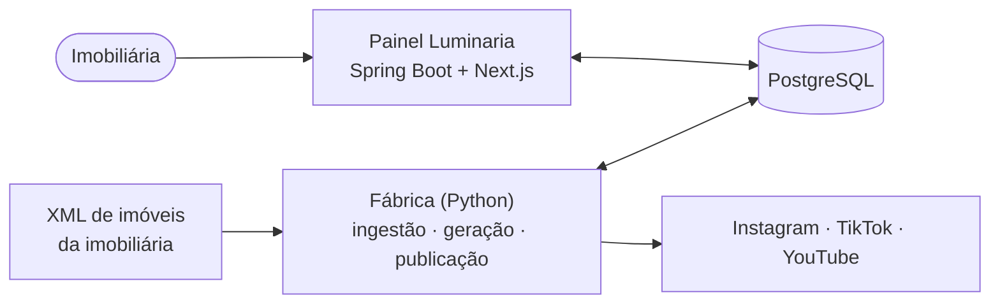

# Luminaria

Painel web SaaS do **LuminaImob** para imobiliárias: a carteira de imóveis vira vídeo para Instagram Reels, TikTok e YouTube Shorts automaticamente, e a imobiliária mantém o controle — vê, aprova, ajusta e agenda cada publicação.

> *A imobiliária só aprova. Não gostou? Refaz na hora.*

## Como funciona

1. A **fábrica** lê o XML, escolhe as fotos, gera o vídeo vertical (zoom ou IA, conforme o plano), escreve a legenda com IA e coloca o vídeo para aprovação.
2. No **painel**, a imobiliária aprova, edita a legenda ou rejeita; o vídeo aprovado entra na grade de horários.
3. No horário, a fábrica publica em cada rede de forma independente.

Painel e fábrica conversam apenas pelo banco: um pode parar sem derrubar o outro.

## Estrutura

| Pasta | Conteúdo |
|---|---|
| `api/` | Backend do painel — Java 21, Spring Boot 3, migrations Flyway |
| `web/` | Frontend — Next.js, TypeScript |
| `fabrica/` | Workers — Python 3.12 (ingestor, gerador, publicador) |
| `contrato/` | Enums, transições e schema de fluxo compartilhados pelas três linguagens |
| `infra/` | Docker Compose e proxy |
| [`docs/`](docs) | Arquitetura, especificação e decisões |

## Documentação

Comece por [docs/README.md](docs/README.md). Destaques:

- [Visão geral e requisitos](docs/00-visao-geral.md)
- [Arquitetura](docs/01-arquitetura.md) e [decisões (ADR)](docs/decisoes.md)
- [Integração painel ↔ fábrica](docs/02-integracao-java-python.md)
- [Padrões de projeto e convenções](docs/12-padroes-de-projeto.md)

Para trabalhar com o Claude neste repositório, as regras estão em [CLAUDE.md](CLAUDE.md).

## Stack

Java 21 · Spring Boot 3 · PostgreSQL 16 · Flyway · Next.js · TypeScript · Python 3.12 · MinIO · Docker · GitHub Actions
