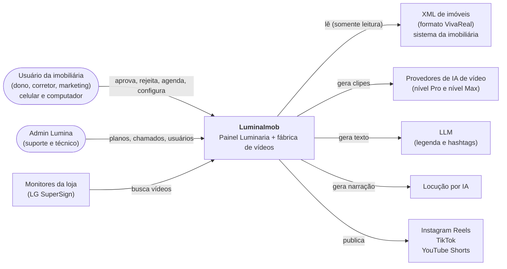
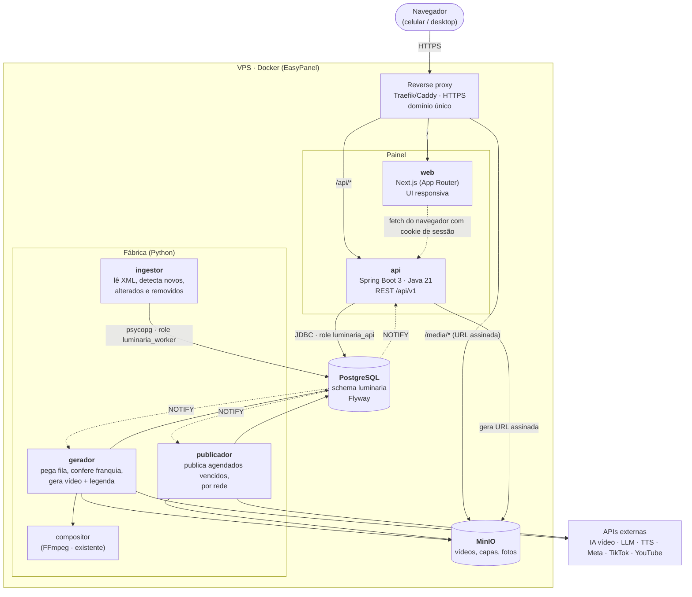
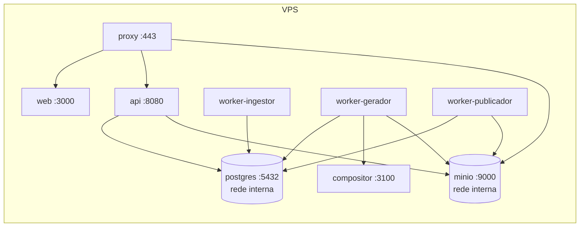

# 01 — Arquitetura

## 1. Princípio

> **O banco é a verdade. O painel é a janela. A fábrica é o Python.**

- O **painel** (Next.js + Spring) lê o estado e grava **decisões** (aprovar, rejeitar, gerar, agendar, configurar).
- A **fábrica** (Python) executa: lê o XML, gera o vídeo, escreve a legenda, publica nas redes.
- Os dois nunca se chamam diretamente. Se o painel cair, a fábrica continua; se a fábrica cair, o painel mostra o estado como está (RNF-LUM-04).

## 2. Contexto (C4 nível 1)



## 3. Containers (C4 nível 2)



### Responsabilidades

| Container | Faz | Não faz |
|---|---|---|
| **web** (Next.js) | Telas, estado de UI, polling dos estados, validação de formulário | Regra de negócio, acesso ao banco, guardar token |
| **api** (Spring) | Autenticação, isolamento de tenant, regras de decisão (aprovar, rejeitar, alocar grade, franquia para exibir), avisos, dashboard, admin | Chamar IA, publicar em rede, ler XML |
| **ingestor** (Python) | Baixar e parsear o XML, normalizar imóvel, marcar `saiu_da_carteira` / `indisponivel` | Decidir pelo cliente |
| **gerador** (Python) | Consumir a fila de geração, verificar a franquia, escolher fotos, gerar clipes, compor, legenda | Aprovar ou agendar |
| **publicador** (Python) | Publicar o que está agendado e vencido, por rede, com retry | Publicar algo não agendado |
| **PostgreSQL** | Estado, filas, histórico, regras de integridade (transições, 1 vídeo por horário) | — |

## 4. Deploy



- **Uma imagem Python, três comandos** (`python -m fabrica ingestor|gerador|publicador`). Escalar o gerador é subir mais réplicas: o `SKIP LOCKED` garante que dois não pegam o mesmo item.
- Postgres e MinIO só na rede interna do Docker; nada exposto além do proxy.
- Orçamento de memória estimado: api ~350–500 MB (`-XX:MaxRAMPercentage=75`, container com 768 MB), web ~150 MB, workers ~100 MB cada.

## 5. Como o Next.js fala com o Spring

Recomendação: **mesma origem**, o proxy manda `/api/*` para o Spring e o resto para o Next.

- O navegador chama `/api/...` direto, com o cookie de sessão. Sem CORS, sem token no JavaScript.
- O Next.js é usado como app de UI (rotas, layout, componentes cliente). Server Components só para casca e conteúdo estático; dados vêm do navegador via TanStack Query.
- O `middleware.ts` do Next só redireciona para `/login` se o cookie não existir. **Quem autoriza é sempre o Spring.**

Alternativa (BFF, Next chamando o Spring no servidor): possível, mas exige repassar o cookie em toda chamada e duplica pontos de falha. Não recomendado na v1.

## 6. Repositórios

```
luminaria/
├── api/          Spring Boot (contém db/migration do Flyway)
├── web/          Next.js
├── fabrica/      Python (workers)
├── contrato/     estados.yaml (fonte única dos enums) + gerador de código
└── docs/         esta documentação
```

Monorepo: uma mudança de contrato (estado novo, coluna nova) vira um único PR que toca banco, Java, Python e front.
