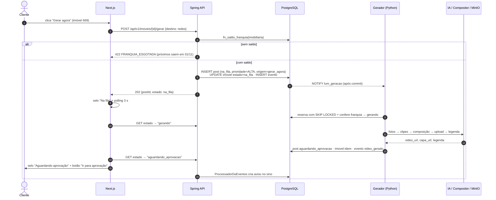
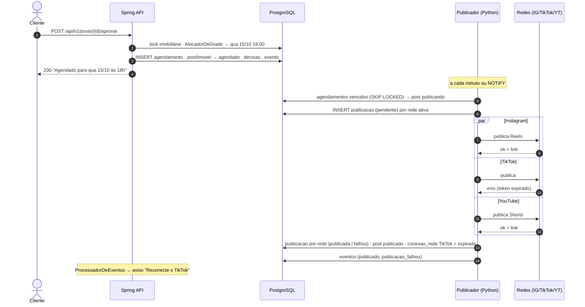
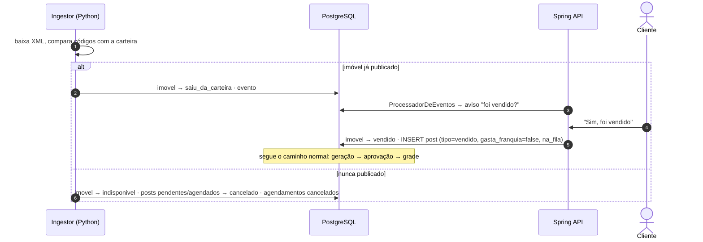

# 02 — Integração Java ↔ Python

Este é o documento que responde "como os dois sistemas conversam". Resposta curta:

> **Pelo PostgreSQL, e só por ele.** O Java grava intenções (linhas em estado `na_fila`, agendamentos). O Python consome essas linhas, faz o trabalho pesado e grava o resultado. Um `NOTIFY` acorda o outro lado na hora; um polling curto garante que nada se perde se o sinal falhar.

## 1. Por que não HTTP entre eles

| Opção | Problema |
|---|---|
| Java chama Python por REST | Se o Python estiver fora, a aprovação falha ou precisa de retry no Java. Geração demora minutos: request não pode esperar. |
| Python chama Java por REST/webhook | Python precisaria de credencial e do Java no ar para gravar resultado. Dois caminhos para o mesmo estado. |
| Fila externa (RabbitMQ/Redis) | Mais um serviço para operar, e a mensagem e o estado no banco podem divergir (dual write). |
| **Banco como contrato** | Estado e "mensagem" são a mesma linha, na mesma transação. Qualquer lado pode cair sem perda de trabalho. |

## 2. O contrato

O contrato entre os dois é formado por quatro coisas, todas versionadas no monorepo:

1. **Schema** — criado só pelo Flyway (repositório `api/src/main/resources/db/migration`).
2. **Enums** — `contrato/estados.yaml` é a fonte única; um script gera `EstadoImovel.java`, `estados.py` e `estados.ts`. No banco, viram `CHECK` constraints criadas por migration.
3. **Transições permitidas** — tabela `transicao_estado` + trigger (ver [03](03-ciclo-de-vida.md)). O banco recusa transição inválida venha de onde vier.
4. **Matriz de escrita** — quem pode escrever em cada coluna (seção 3), reforçada por `GRANT`s.

### Checagem de versão no start do Python

O worker não sobe se o schema estiver mais velho ou mais novo do que ele conhece:

```python
ESQUEMA_ESPERADO = "12"   # gerado no build a partir da última migration

def checar_schema(conn):
    v = conn.execute("""
        SELECT version FROM luminaria.flyway_schema_history
        WHERE success ORDER BY installed_rank DESC LIMIT 1
    """).scalar_one()
    if v != ESQUEMA_ESPERADO:
        raise SystemExit(f"Schema {v}, worker espera {ESQUEMA_ESPERADO}. Faça o deploy na ordem: api (migra) -> fabrica.")
```

Ordem de deploy: **api primeiro** (Flyway migra) → **fábrica depois**. Migrations devem ser compatíveis com a versão anterior do worker (expand/contract: adicionar coluna nullable, depois usar, depois remover).

## 3. Quem escreve o quê

| Tabela / coluna | Java (api) | Python (fábrica) |
|---|---|---|
| `imobiliaria`, `plano_imobiliaria`, `grade_horario`, `usuario` | escreve | só lê (exceto zerar `ingestao_solicitada_em`) |
| `post.previsao_fim`, `etapa_erro`, `erro_amigavel` | só lê | **escreve** |
| `imovel` — dados (preço, fotos, descrição…) | só lê | **escreve** (ingestão) |
| `imovel.estado` | transições do cliente/admin | transições do sistema |
| `post` — criação | `gerar agora`, `gerar de novo`, rejeição, vendido, chamado | fila automática (imóvel novo) |
| `post` — `estado`, `video_url`, `legenda_ia`, `travado_*`, `tentativas`, `erro` | estados de decisão | estados de execução |
| `post.legenda_editada`, `hashtags_editadas` | **escreve** | só lê (nunca sobrescreve — RN-LUM-08) |
| `decisao` | escreve | — |
| `agendamento` | escreve | lê (publicador) |
| `publicacao` | lê | **escreve** |
| `conexao_rede` | escreve (OAuth/reconectar) | lê token, marca `expirada` |
| `evento` | escreve (ações de usuário) | escreve (ações de sistema) |
| `notificacao` | escreve (a partir dos eventos) | — |
| `chamado` | escreve | — |
| `fechamento_franquia` | lê | escreve (job mensal) |

Isso vira `GRANT` por coluna para o role `luminaria_worker` (ver [05](05-seguranca.md)).

## 4. As três filas

Nenhuma fila é uma tabela separada: **a própria linha de estado é o item da fila**.

| Fila | Item | Produtor | Consumidor | Canal NOTIFY |
|---|---|---|---|---|
| Geração | `post` com `estado = 'na_fila'` | Java e Python (ingestão) | gerador | `lum_geracao` |
| Publicação | `agendamento` vencido de `post` em `agendado` | Java (aprovar) | publicador | `lum_publicacao` |
| Eventos → avisos | `evento` com `id > cursor` | Java e Python | Java (`ProcessadorDeEventos`) | `lum_evento` |
| Ler XML agora | `imobiliaria.ingestao_solicitada_em` preenchido | Java (Admin) | ingestor | `lum_ingestao` |
| Republicar uma rede | `publicacao` voltando a `pendente` | Java (Admin · Falhas) | publicador | `lum_publicacao` |

Os dois últimos atendem aos botões "Ler agora" e "Tentar de novo" (por rede) do Admin. O ingestor zera `ingestao_solicitada_em` ao terminar; o publicador, ao ver uma `publicacao` pendente de um post já `publicado`, publica **só aquela rede** sem mexer no estado do post.

### 4.1 Consumo da fila de geração (gerador Python)

Três regras: pegar com `SKIP LOCKED`, verificar a franquia **antes** de gerar (RN-LUM-14) com trava por imobiliária, e **não** segurar a transação aberta durante a geração (que leva minutos).

```sql
-- Transação curta 1: reservar o próximo item
BEGIN;

SELECT p.id, p.imobiliaria_id, p.gasta_franquia
FROM luminaria.post p
WHERE p.estado = 'na_fila'
  AND (p.disponivel_em IS NULL OR p.disponivel_em <= now())
ORDER BY p.prioridade DESC, p.criado_em
FOR UPDATE SKIP LOCKED
LIMIT 1;

-- se gasta_franquia: serializa a conta por imobiliária
SELECT pg_advisory_xact_lock(hashtextextended(:imobiliaria_id::text, 0));
SELECT disponivel, ilimitado FROM luminaria.fn_saldo_franquia(:imobiliaria_id);

-- sem saldo: o item espera o mês seguinte, sem ser lido de novo a cada ciclo
UPDATE luminaria.post
   SET disponivel_em = luminaria.fn_inicio_proximo_mes()
 WHERE id = :id;                                    -- e COMMIT

-- com saldo:
UPDATE luminaria.post
   SET estado = 'gerando',
       franquia_consumida_em = CASE WHEN gasta_franquia THEN now() END,
       travado_por = :worker_id,
       travado_ate = now() + interval '30 minutes',
       tentativas  = tentativas + 1
 WHERE id = :id AND estado = 'na_fila';
COMMIT;
```

Depois, **fora de transação**: escolher fotos → gerar clipes (IA ou zoom) → compor → subir no MinIO → legenda. Por fim:

```sql
-- Transação curta 2: gravar o resultado
UPDATE luminaria.post
   SET estado = CASE WHEN destino = 'monitores' THEN 'nos_monitores'
                     WHEN :aprovacao_ligada THEN 'aguardando_aprovacao'
                     ELSE 'aprovado_auto' END,
       video_url = :video, capa_url = :capa,
       legenda_ia = :legenda, hashtags_ia = :hashtags,
       travado_por = NULL, travado_ate = NULL, gerado_em = now()
 WHERE id = :id AND estado = 'gerando' AND travado_por = :worker_id;
-- + UPDATE imovel.estado + INSERT evento('video_gerado')
```

O `AND travado_por = :worker_id` impede que um worker "atrasado" sobrescreva o trabalho de outro que reassumiu o item.

> `aprovado_auto`: com a aprovação desligada (RF-LUM-52), o Python não decide horário. Ele marca o post e o Java (`ProcessadorDeEventos`) aloca na grade com a **mesma** regra do botão Aprovar. Assim a lógica de grade existe num lugar só.

### 4.2 Itens travados (worker morreu no meio)

Um job no gerador, a cada 5 min:

```sql
UPDATE luminaria.post
   SET estado = CASE WHEN tentativas >= 3 THEN 'falhou' ELSE 'na_fila' END,
       travado_por = NULL, travado_ate = NULL,
       disponivel_em = now() + (interval '2 minutes' * power(2, tentativas))
 WHERE estado = 'gerando' AND travado_ate < now();
```

Chamadas pagas (IA de vídeo) usam o `post.id` + número da tentativa como chave de idempotência, e o job da IA é salvo em `post.ia_job_id`: ao retomar, o worker consulta o job existente antes de pedir outro. Isso evita pagar duas vezes pelo mesmo clipe.

### 4.3 Publicação (publicador Python)

A cada minuto **e** a cada `NOTIFY lum_publicacao`:

```sql
SELECT a.post_id
FROM luminaria.agendamento a
JOIN luminaria.post p ON p.id = a.post_id
WHERE a.cancelado_em IS NULL
  AND a.agendado_para <= now()
  AND p.estado = 'agendado'
ORDER BY a.agendado_para
FOR UPDATE OF p SKIP LOCKED
LIMIT 10;
```

Para cada post: `estado = 'publicando'`, cria uma linha em `publicacao` **por rede ativa** (`pendente`), commit; publica cada rede de forma independente (RN-LUM-07); grava `publicada` ou `falhou` por rede. O post vira `publicado` se pelo menos uma deu certo. Atraso (RN-LUM-05) = `publicado_em - agendado_para`, mostrado no detalhe.

## 5. Sinais: LISTEN/NOTIFY

O polling garante; o NOTIFY só deixa rápido ("Gerar agora" começa em ~1 s, não em 30 s).

Os NOTIFY são disparados por **trigger**, não pelo código, para nenhum lado esquecer:

```sql
CREATE FUNCTION luminaria.trg_notificar_fila() RETURNS trigger AS $$
BEGIN
  IF NEW.estado = 'na_fila' THEN
    PERFORM pg_notify('lum_geracao', NEW.id::text);
  ELSIF NEW.estado = 'agendado' THEN
    PERFORM pg_notify('lum_publicacao', NEW.id::text);
  END IF;
  RETURN NEW;
END $$ LANGUAGE plpgsql;

CREATE TRIGGER post_notificar
AFTER INSERT OR UPDATE OF estado ON luminaria.post
FOR EACH ROW EXECUTE FUNCTION luminaria.trg_notificar_fila();
```

O `pg_notify` só é entregue **depois do COMMIT**: o worker nunca acorda para ler algo que ainda não existe.

Lado Python (psycopg 3):

```python
with psycopg.connect(DSN, autocommit=True) as conn:
    conn.execute("LISTEN lum_geracao")
    while True:
        processar_fila_ate_esvaziar()
        # espera um sinal ou 15 s, o que vier primeiro
        for _ in conn.notifies(timeout=15, stop_after=1):
            pass
```

Lado Java: `PGConnection.getNotifications(timeoutMs)` numa thread dedicada com conexão própria (fora do pool do Hikari), acordando o `ProcessadorDeEventos`.

## 6. Do Python para a tela

O Python não avisa o Java. Ele grava o estado e um **evento**. Dois consumidores:

1. **Tela**: o front consulta `/api/v1/imoveis/{id}/estado` a cada 3 s **só enquanto** houver item `na_fila`/`gerando` na tela (TanStack Query `refetchInterval` condicional). Sem WebSocket na v1.
2. **Avisos (sino)**: o `ProcessadorDeEventos` (Java) lê eventos novos por cursor e cria as notificações (vídeo novo para aprovar, publicação falhou, saiu da carteira, franquia 80%…). Regra de aviso fica toda no Java.

```sql
-- cursor guardado em luminaria.cursor_processamento(nome='avisos', ultimo_evento_id)
SELECT * FROM luminaria.evento WHERE id > :ultimo ORDER BY id LIMIT 200;
```

`evento.id` é `bigint` de sequência, e o processador lê só eventos com `criado_em < now() - interval '2 seconds'` para não pular IDs de transações ainda abertas.

## 7. Concorrência entre os dois

Cenários reais e como o banco resolve:

| Corrida | Proteção |
|---|---|
| Cliente aprova enquanto a ingestão marca o imóvel `indisponivel` | Updates condicionais (`WHERE estado = 'aguardando_aprovacao'`). Quem chega depois recebe 0 linhas → Java responde **409** "o imóvel mudou, atualize". |
| Dois cliques em "Gerar agora" | Índice único parcial: um só post `na_fila`/`gerando` por imóvel. |
| Duas aprovações no mesmo horário da grade | `pg_advisory_xact_lock` por imobiliária no alocador + índice único `(imobiliaria_id, agendado_para)` em agendamentos ativos (RN-LUM-04). |
| Dois geradores gastando a última vaga da franquia | `pg_advisory_xact_lock` por imobiliária antes de `fn_saldo_franquia`. |
| Cliente edita legenda enquanto o Python grava a legenda da IA | Colunas separadas: `legenda_ia` (Python) e `legenda_editada` (Java). O que vai ao ar é `COALESCE(legenda_editada, legenda_ia)`. |
| Admin manda "tentar de novo" num item `gerando` | Transição `gerando → na_fila` só é permitida ao ator `sistema` (trigger recusa). |

## 8. Sequências

### 8.1 Gerar agora (RF-LUM-24)



### 8.2 Aprovar com grade e publicar (RF-LUM-11)



### 8.3 Imóvel saiu do XML (RF-LUM-18, RN-LUM-09)



## 9. Estrutura interna da fábrica (Python)

```
fabrica/
├── fabrica/
│   ├── __main__.py           # python -m fabrica ingestor|gerador|publicador
│   ├── config.py             # pydantic-settings (env)
│   ├── db.py                 # pool psycopg 3, checar_schema()
│   ├── contrato/estados.py   # GERADO de contrato/estados.yaml
│   ├── ingestao/             # parser VivaReal, normalização, diff por hash
│   ├── geracao/
│   │   ├── fila.py           # reservar(), concluir(), reaper()
│   │   ├── franquia.py       # chama fn_saldo_franquia
│   │   ├── geradores/        # essencial.py (zoom FFmpeg), pro.py, max.py  ← Protocol comum
│   │   ├── acessorios/       # motion_graphics.py, locucao.py
│   │   └── legenda.py
│   ├── publicacao/
│   │   ├── fila.py
│   │   └── redes/            # instagram.py, tiktok.py, youtube.py ← Protocol Publicador
│   └── eventos.py            # registrar_evento()
└── tests/                    # pytest + testcontainers-postgres
```

Bibliotecas: `psycopg[binary,pool]` 3, `pydantic-settings`, `lxml`, `httpx`, `tenacity` (retry), `boto3`/`minio`, `structlog`. **Sem ORM e sem Alembic**: SQL explícito, porque o schema é do Flyway.

Os geradores e publicadores são "peças trocáveis" :

```python
class GeradorVideo(Protocol):
    nivel: NivelVideo
    def gerar(self, post: PostParaGerar, fotos: list[Foto]) -> ResultadoGeracao: ...

class PublicadorRede(Protocol):
    rede: Rede
    def publicar(self, video_url: str, legenda: str, conexao: ConexaoRede) -> ResultadoPublicacao: ...
```

## 10. Checklist para o desenvolvedor

- [ ] Nunca `ALTER`/`CREATE` no Python. Mudou o banco → migration Flyway.
- [ ] Todo `UPDATE` de estado tem `WHERE estado = <esperado>` e confere `rowcount`.
- [ ] Nenhuma transação aberta durante chamada externa (IA, rede, MinIO).
- [ ] Toda ação grava `evento` na mesma transação da mudança de estado (RN-LUM-11).
- [ ] Python nunca escreve `legenda_editada`, `decisao`, `agendamento`.
- [ ] Teste de integração com Testcontainers rodando **Flyway + worker** juntos.
