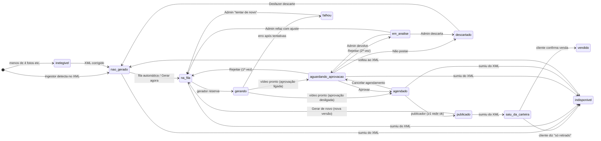
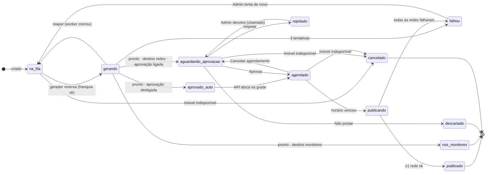
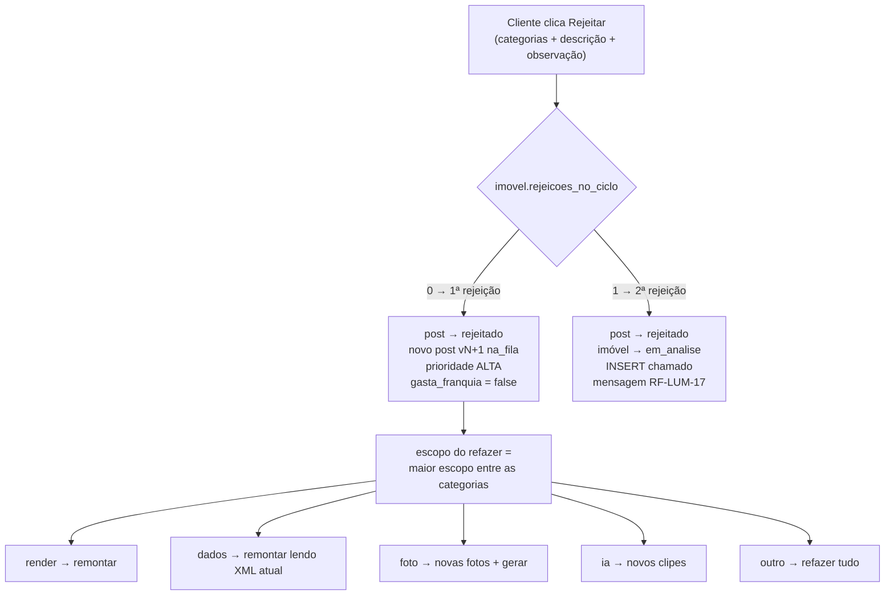

# 03 — Ciclo de vida (máquinas de estado)

Há **duas** máquinas, ligadas mas separadas:

- **Imóvel** — o que o cliente vê no selo do card, na pizza do Dashboard e no Admin.
- **Post** — cada versão de vídeo (v1, v2…), inclusive o post "Vendido" e, no futuro, o post próprio sem imóvel (ADR-05).

Por que separar: o imóvel `vendido` continua `vendido` enquanto o **post** "Vendido" passa por fila → aprovação → grade. E um vídeo "só para os monitores" tem post próprio sem mexer no estado do imóvel (RN-LUM-10).

## 1. Imóvel



Marcador **Refeito (vN)**: não é estado; é derivado de `post.numero_versao > 1` do post atual.

## 2. Post (versão de vídeo)



`publicado` é final (RN-LUM-06): aprovar ou editar de novo não republica.

## 3. Quem pode fazer cada transição

Ator gravado na transação: `cliente`, `admin` (vindo do Java) ou `sistema` (vindo do Python ou de um job do Java).

### Imóvel

| De → Para | Ator | Requisito |
|---|---|---|
| `nao_gerado` → `na_fila` | sistema, cliente | fila automática, RF-LUM-24 |
| `na_fila` → `gerando` | sistema | — |
| `gerando` → `aguardando_aprovacao` / `agendado` / `falhou` | sistema | RF-LUM-52 |
| `aguardando_aprovacao` → `agendado` | cliente (ou sistema, se aprovação desligada) | RF-LUM-11 |
| `aguardando_aprovacao` → `na_fila` | cliente | RN-LUM-01 |
| `aguardando_aprovacao` → `em_analise` | cliente | RN-LUM-02 |
| `aguardando_aprovacao` → `descartado` | cliente | RF-LUM-16 |
| `agendado` → `aguardando_aprovacao` | cliente | RF-LUM-12 |
| `agendado` → `publicado` | sistema | — |
| `em_analise` → qualquer | **admin** | RN-LUM-02 |
| `falhou` → `na_fila` | admin | RF-LUM-63 |
| `publicado` → `na_fila` | cliente | RF-LUM-25 |
| `*` → `saiu_da_carteira` / `indisponivel` | sistema | RN-LUM-09 |
| `saiu_da_carteira` → `vendido` / `indisponivel` | cliente | RF-LUM-18 |
| `descartado` → `nao_gerado` | cliente | RF-LUM-27 |

## 4. O banco recusa transição inválida

Duas linguagens escrevem estado. A regra de **decidir** fica no código (Java ou Python), mas a regra de **validade** fica no banco, para nenhum dos dois conseguir pular uma etapa:

```sql
CREATE TABLE luminaria.transicao_estado (
  entidade text NOT NULL CHECK (entidade IN ('imovel','post')),
  de       text NOT NULL,
  para     text NOT NULL,
  atores   text[] NOT NULL,          -- {cliente,admin,sistema}
  PRIMARY KEY (entidade, de, para)
);

CREATE FUNCTION luminaria.trg_validar_transicao() RETURNS trigger AS $$
DECLARE
  v_ator text := coalesce(current_setting('luminaria.ator', true), 'sistema');
BEGIN
  IF NEW.estado IS DISTINCT FROM OLD.estado THEN
    PERFORM 1 FROM luminaria.transicao_estado
     WHERE entidade = TG_ARGV[0] AND de = OLD.estado AND para = NEW.estado
       AND v_ator = ANY(atores);
    IF NOT FOUND THEN
      RAISE EXCEPTION 'Transição inválida em %: % -> % (ator %)',
        TG_ARGV[0], OLD.estado, NEW.estado, v_ator
        USING ERRCODE = 'P0001';
    END IF;
    NEW.estado_desde := now();
  END IF;
  RETURN NEW;
END $$ LANGUAGE plpgsql;

CREATE TRIGGER imovel_transicao BEFORE UPDATE OF estado ON luminaria.imovel
  FOR EACH ROW EXECUTE FUNCTION luminaria.trg_validar_transicao('imovel');
CREATE TRIGGER post_transicao BEFORE UPDATE OF estado ON luminaria.post
  FOR EACH ROW EXECUTE FUNCTION luminaria.trg_validar_transicao('post');
```

- O Java faz `SELECT set_config('luminaria.ator', 'cliente', true)` no início de cada transação (junto do tenant; ver [05](05-seguranca.md)). O Python não precisa: o padrão é `sistema`.
- A tabela `transicao_estado` é populada por uma migration (`R__transicoes.sql`, repeatable) gerada de `contrato/estados.yaml`.
- No Java, `P0001` vira **409 Conflict**.

## 5. Regras de rejeição (RN-LUM-01 / 02)



- `imovel.rejeicoes_no_ciclo` volta a 0 quando um post do imóvel é aprovado ou quando o Admin resolve o chamado.
- Escopo, do menor para o maior: `remontar` < `novas_fotos` = `novos_clipes` < `tudo`. Com `novas_fotos` + `novos_clipes`, vale `tudo`. O escopo vai para `post.escopo_refazer` e o gerador obedece.
- "Erro da IA" só aparece em Pro/Max; "Locução com erro" só com o acessório Locução. A API valida contra o **nível usado no post**, não o plano de hoje.
