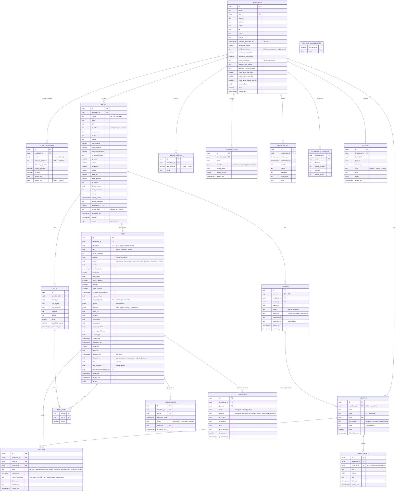

# 04 — Banco de dados

PostgreSQL 16+, schema `luminaria`, extensões `pgcrypto`, `pg_trgm`, `unaccent`, `citext`.

## 1. Modelo ER



Tabelas de infraestrutura fora do diagrama: `spring_session`, `spring_session_attributes` (Spring Session JDBC), `token_usuario` (convite e redefinição de senha: `tipo`, `token_hash`, `expira_em`, `usado_em`), `cursor_processamento`, `transicao_estado`, `worker_heartbeat` (`papel`, `instancia`, `visto_em`, `versao` — gravada pela fábrica, lida pelo Admin), `flyway_schema_history`.

`fluxo_automacao` (global, versões imutáveis) e as colunas `imobiliaria.fluxo_id` e `post.fluxo_id` estão no [11 §6](11-fluxos-de-automacao.md#banco).

`ingestao_xml.estado`: `ok`, `sem_mudanca` (304), `suspeita` (trava de segurança do [09 §3.2](09-fabrica-python.md#32-fluxo)) ou `erro`.

## 2. Regras do modelo

1. **`imobiliaria_id` em toda tabela de dado de cliente**, inclusive filhas (`foto`, `publicacao`, `decisao`). Duplicar o tenant nas filhas é proposital: permite RLS sem join e índice composto.
2. **IDs `uuid`** (v7, gerados na aplicação, ordenáveis por tempo) — não dá para "chutar" o id de outra imobiliária. `evento.id` é `bigint` porque serve de cursor.
3. **Estados como `text` + `CHECK`**, não `ENUM` do Postgres: acrescentar valor a um `CHECK` é uma migration simples e transacional, e mapeia direto para `@Enumerated(STRING)` no Java e `StrEnum` no Python.
4. **Nada é apagado**: versões, decisões e eventos ficam. Usuário é desativado, não removido.
5. **Dinheiro em `numeric(12,2)`**, datas em `timestamptz` (UTC no banco; fuso `America/Sao_Paulo` só na exibição e no cálculo da grade).
6. Chaves estrangeiras compostas com o tenant onde importa: `FOREIGN KEY (imobiliaria_id, imovel_id) REFERENCES imovel (imobiliaria_id, id)` — impede, por construção, um post da imobiliária A apontar para um imóvel da B.

## 3. Restrições e índices que carregam regra de negócio

```sql
-- um código por imobiliária
CREATE UNIQUE INDEX uq_imovel_codigo ON imovel (imobiliaria_id, codigo);

-- no máximo um post em produção por imóvel (sem clique duplo em "Gerar agora")
CREATE UNIQUE INDEX uq_post_em_producao ON post (imovel_id)
  WHERE estado IN ('na_fila','gerando') AND destino = 'redes';

-- RN-LUM-04: um vídeo por horário da grade
CREATE UNIQUE INDEX uq_agendamento_horario ON agendamento (imobiliaria_id, agendado_para)
  WHERE cancelado_em IS NULL;
CREATE UNIQUE INDEX uq_agendamento_post ON agendamento (post_id) WHERE cancelado_em IS NULL;

-- grade sem horário repetido
CREATE UNIQUE INDEX uq_grade ON grade_horario (imobiliaria_id, dia_semana, hora);

-- um plano vigente por vez
ALTER TABLE plano_imobiliaria ADD CONSTRAINT ex_plano_sobreposto
  EXCLUDE USING gist (imobiliaria_id WITH =,
                      daterange(vigente_de, vigente_ate, '[)') WITH &&);  -- requer btree_gist

-- acessórios não existem no Essencial Ilimitado (RN-LUM-15)
ALTER TABLE plano_imobiliaria ADD CONSTRAINT ck_acessorios_ilimitado
  CHECK (NOT (nivel = 'essencial' AND franquia_mensal IS NULL AND (motion_graphics OR locucao)));

-- uma publicação por rede por post
CREATE UNIQUE INDEX uq_publicacao_rede ON publicacao (post_id, rede);

-- filas
CREATE INDEX ix_post_fila ON post (prioridade DESC, criado_em) WHERE estado = 'na_fila';
CREATE INDEX ix_agendamento_vencer ON agendamento (agendado_para) WHERE cancelado_em IS NULL;

-- telas
CREATE INDEX ix_imovel_estado ON imovel (imobiliaria_id, estado);
CREATE INDEX ix_post_aprovacao ON post (imobiliaria_id, estado_desde) WHERE estado = 'aguardando_aprovacao';
CREATE INDEX ix_evento_imovel ON evento (imovel_id, criado_em);
CREATE INDEX ix_notificacao_nao_lida ON notificacao (imobiliaria_id, usuario_id) WHERE lida_em IS NULL;
```

## 4. Busca inteligente (RF-LUM-22)

Sem Elasticsearch: `pg_trgm` + `unaccent` no próprio Postgres.

```sql
-- unaccent não é IMMUTABLE; embrulhar para poder indexar
CREATE FUNCTION luminaria.sem_acento(text) RETURNS text
  LANGUAGE sql IMMUTABLE PARALLEL SAFE
  AS $$ SELECT public.unaccent('public.unaccent'::regdictionary, lower($1)) $$;

ALTER TABLE imovel ADD COLUMN busca_texto text GENERATED ALWAYS AS (
  luminaria.sem_acento(concat_ws(' ', codigo, titulo, tipo, condominio, bairro, cidade, descricao))
) STORED;

CREATE INDEX ix_imovel_busca ON imovel USING gin (busca_texto gin_trgm_ops);

-- consulta: código exato primeiro, depois similaridade
SELECT id, codigo, titulo,
       (codigo = :q) AS exato,
       word_similarity(luminaria.sem_acento(:q), busca_texto) AS score
FROM imovel
WHERE imobiliaria_id = :tenant
  AND (codigo = :q OR luminaria.sem_acento(:q) <% busca_texto)
ORDER BY exato DESC, score DESC
LIMIT 24;
```

Cobre "669", "esperanca", "aparatamento" e "sunset". Com ~2.000 imóveis por imobiliária, responde em milissegundos.

## 5. Franquia (RN-LUM-13, RN-LUM-14, RF-LUM-82)

Regra: saldo do mês = franquia do plano + sobra do mês anterior − vídeos que gastaram franquia no mês. A sobra é gasta primeiro e só a franquia **própria** não usada passa adiante (sobra da sobra se perde).

- `fechamento_franquia` é gravado pelo Python no dia 1 às 00:05 (fuso SP), para o mês anterior. É idempotente (`ON CONFLICT DO UPDATE`). Também é o que alimenta a tela Consumo do Admin.
- `fn_saldo_franquia` é **a única** conta. Java (contador e bloqueio de botão) e Python (antes de gerar) chamam a mesma função.

```sql
CREATE FUNCTION luminaria.fn_mes_atual() RETURNS date LANGUAGE sql STABLE AS
$$ SELECT date_trunc('month', now() AT TIME ZONE 'America/Sao_Paulo')::date $$;

CREATE FUNCTION luminaria.fn_saldo_franquia(p_imob uuid)
RETURNS TABLE (franquia int, sobra int, usados int, disponivel int, ilimitado boolean)
LANGUAGE sql STABLE AS $$
  WITH plano AS (
    SELECT franquia_mensal
    FROM luminaria.plano_imobiliaria
    WHERE imobiliaria_id = p_imob
      AND vigente_de <= (now() AT TIME ZONE 'America/Sao_Paulo')::date
      AND (vigente_ate IS NULL OR vigente_ate > (now() AT TIME ZONE 'America/Sao_Paulo')::date)
  ), anterior AS (
    SELECT sobra_gerada FROM luminaria.fechamento_franquia
    WHERE imobiliaria_id = p_imob
      AND mes = (luminaria.fn_mes_atual() - interval '1 month')::date
  ), uso AS (
    SELECT count(*)::int AS n FROM luminaria.post
    WHERE imobiliaria_id = p_imob AND gasta_franquia
      AND franquia_consumida_em >= (luminaria.fn_mes_atual()::timestamp AT TIME ZONE 'America/Sao_Paulo')
  )
  SELECT p.franquia_mensal,
         coalesce(a.sobra_gerada, 0),
         u.n,
         CASE WHEN p.franquia_mensal IS NULL THEN NULL
              ELSE greatest(0, p.franquia_mensal + coalesce(a.sobra_gerada,0) - u.n) END,
         p.franquia_mensal IS NULL
  FROM plano p CROSS JOIN uso u LEFT JOIN anterior a ON true;
$$;
```

Fechamento do mês `m`: `sobra_gerada = greatest(0, franquia - greatest(0, usados - sobra_recebida))`.

Troca de plano (RF-LUM-83): subir = fecha a linha vigente hoje e abre outra a partir de hoje (vale no mesmo mês); descer = abre a nova com `vigente_de` = dia 1 do mês seguinte.

## 6. Convenção Flyway

```
api/src/main/resources/db/migration/
├── V001__extensoes_e_schema.sql
├── V002__identidade.sql              usuario, token_senha, spring_session
├── V003__imobiliaria_e_planos.sql
├── V004__carteira.sql                imovel, foto, busca
├── V005__posts_e_decisoes.sql
├── V006__agenda_e_publicacao.sql
├── V007__chamados_avisos_eventos.sql
├── V008__franquia.sql                fechamento_franquia, funções
├── V009__transicoes_trigger.sql
├── V010__rls_e_roles.sql
├── R__transicoes.sql                 dados de transicao_estado (repeatable, gerado)
└── R__horarios_recomendados.sql
```

- `V<NNN>__<descricao_snake>.sql`, três dígitos, uma preocupação por arquivo.
- **Migration aplicada nunca é editada.** Corrigiu? Nova migration.
- Dados de exemplo só no perfil `dev` (`db/seed-dev/`, via `spring.flyway.locations` por perfil). Produção nunca recebe seed.
- `spring.flyway.validate-on-migrate=true`, `out-of-order=false`, `baseline-on-migrate=false`.
- `spring.jpa.hibernate.ddl-auto=validate`: o Hibernate confere, nunca cria.
- O Flyway roda com um usuário dono do schema (`luminaria_owner`); a aplicação roda com `luminaria_api`, que não tem DDL (ver [05](05-seguranca.md)).
