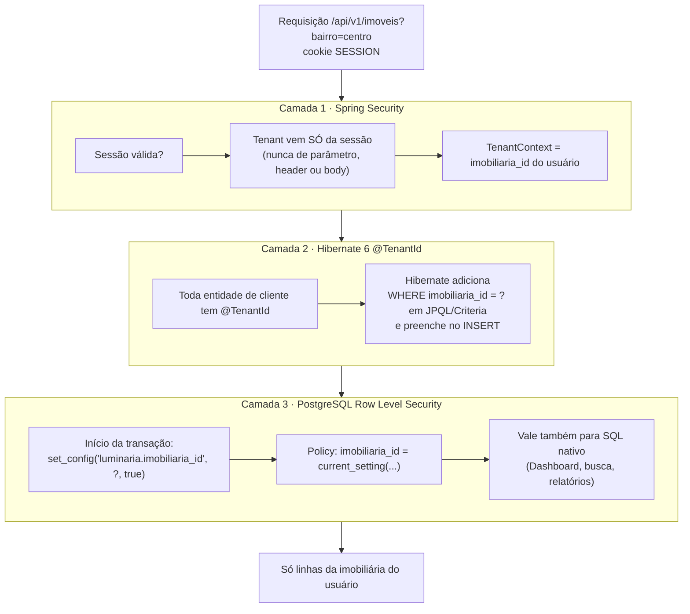
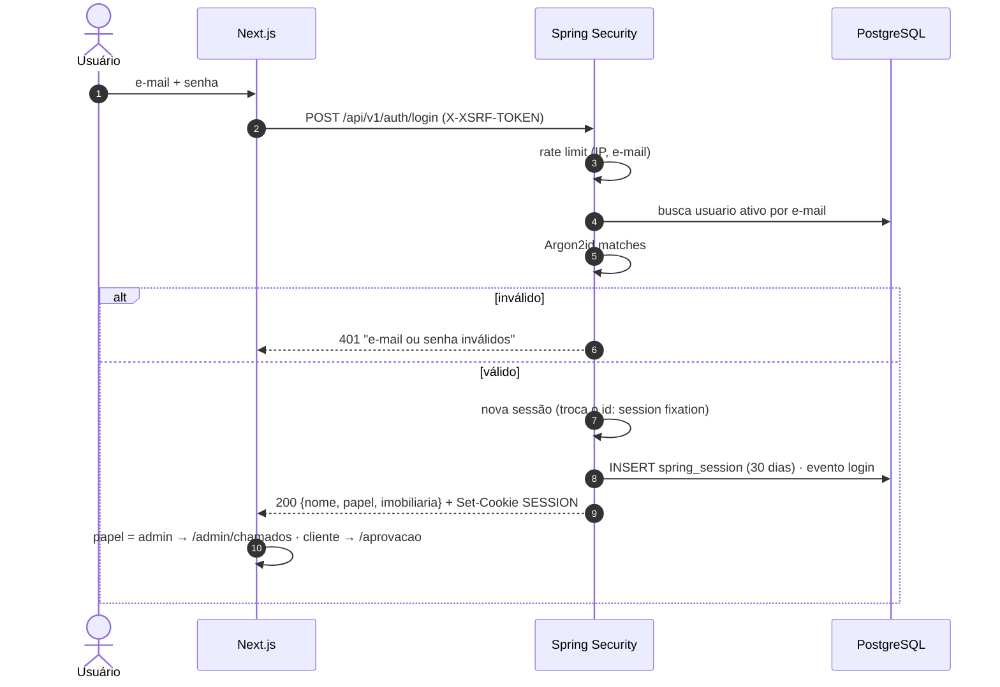

# 05 — Segurança e multi-tenant

Requisito que não se negocia (RNF-LUM-05): **uma imobiliária nunca vê os dados da outra.** O resto segue a regra "simples e bem feita": controles padrão do Spring, sem invenção.

## 1. Isolamento em três camadas

Uma falha em uma camada não vaza dados, porque a próxima segura.



### 1.1 Camada 1 — o tenant vem da sessão

```java
public record UsuarioAutenticado(UUID id, UUID imobiliariaId, Papel papel, String nome)
    implements Serializable {}

// Nenhum endpoint de cliente recebe imobiliariaId. Exemplo:
@GetMapping("/api/v1/imoveis/{id}")
ImovelDetalheDto detalhe(@PathVariable UUID id) { ... }   // o tenant é implícito
```

Endpoints do Admin ficam em `/api/v1/admin/**` com `hasRole('ADMIN')`, e só eles aceitam `imobiliariaId` no caminho.

### 1.2 Camada 2 — Hibernate `@TenantId`

```java
@Entity @Table(name = "imovel", schema = "luminaria")
public class Imovel {
    @Id private UUID id;
    @TenantId @Column(name = "imobiliaria_id", nullable = false, updatable = false)
    private UUID imobiliariaId;
    ...
}

@Component
class ResolvedorDeTenant implements CurrentTenantIdentifierResolver<UUID> {
    public UUID resolveCurrentTenantIdentifier() { return TenantContext.atualOuRaiz(); }
    public boolean validateExistingCurrentSessions() { return true; }
    public boolean isRoot(UUID t) { return TenantContext.RAIZ.equals(t); } // Admin global
}
```

Atenção: `@TenantId` **não** filtra SQL nativo (`@Query(nativeQuery = true)`, `JdbcTemplate`). É por isso que a camada 3 existe.

### 1.3 Camada 3 — Row Level Security

```sql
-- roles
CREATE ROLE luminaria_owner NOLOGIN;            -- dono das tabelas (Flyway)
CREATE ROLE luminaria_api    LOGIN PASSWORD '...';  -- Spring: sem DDL, sujeito a RLS
CREATE ROLE luminaria_worker LOGIN PASSWORD '...';  -- Python: todas as imobiliárias, colunas limitadas

-- para cada tabela de cliente (exemplo: imovel)
ALTER TABLE luminaria.imovel ENABLE ROW LEVEL SECURITY;
ALTER TABLE luminaria.imovel FORCE ROW LEVEL SECURITY;

CREATE POLICY tenant_api ON luminaria.imovel TO luminaria_api
  USING (
    current_setting('luminaria.admin', true) = 'true'
    OR imobiliaria_id = nullif(current_setting('luminaria.imobiliaria_id', true), '')::uuid
  )
  WITH CHECK (
    current_setting('luminaria.admin', true) = 'true'
    OR imobiliaria_id = nullif(current_setting('luminaria.imobiliaria_id', true), '')::uuid
  );

CREATE POLICY fabrica ON luminaria.imovel TO luminaria_worker USING (true) WITH CHECK (true);
```

Sem `set_config`, a variável é vazia e a policy não devolve nenhuma linha: **o erro de esquecer é "não aparece nada", nunca "aparece tudo"**.

Como o Spring liga o tenant em cada transação (conexões do pool são reaproveitadas, então usa-se `is_local = true`, que some no fim da transação):

```java
public class TenantJpaTransactionManager extends JpaTransactionManager {
    @Override
    protected void doBegin(Object transaction, TransactionDefinition def) {
        super.doBegin(transaction, def);
        EntityManager em = EntityManagerFactoryUtils.getTransactionalEntityManager(getEntityManagerFactory());
        var ctx = TenantContext.atual();
        em.unwrap(Session.class).doWork(conn -> {
            try (var ps = conn.prepareStatement("""
                SELECT set_config('luminaria.imobiliaria_id', ?, true),
                       set_config('luminaria.admin', ?, true),
                       set_config('luminaria.ator', ?, true)""")) {
                ps.setString(1, ctx.imobiliariaId() == null ? "" : ctx.imobiliariaId().toString());
                ps.setString(2, String.valueOf(ctx.isAdminGlobal()));
                ps.setString(3, ctx.ator());      // cliente | admin | sistema
                ps.execute();
            }
        });
    }
}
```

Regra decorrente: **todo acesso ao banco passa por `@Transactional`** (inclusive leitura: `@Transactional(readOnly = true)`). Um teste de arquitetura (ArchUnit) garante que repositórios só são chamados de classes `@Service` transacionais.

### 1.4 Grants do worker (matriz do [02](02-integracao-java-python.md#3-quem-escreve-o-quê))

```sql
GRANT SELECT ON ALL TABLES IN SCHEMA luminaria TO luminaria_worker;
REVOKE SELECT ON luminaria.usuario, luminaria.token_usuario,
                 luminaria.spring_session, luminaria.spring_session_attributes
  FROM luminaria_worker;
GRANT INSERT, UPDATE ON luminaria.imovel, luminaria.foto, luminaria.ingestao_xml,
                         luminaria.publicacao, luminaria.fechamento_franquia TO luminaria_worker;
GRANT INSERT ON luminaria.post, luminaria.post_foto, luminaria.evento TO luminaria_worker;
GRANT UPDATE (estado, video_url, capa_url, legenda_ia, hashtags_ia, travado_por, travado_ate,
              disponivel_em, tentativas, ia_job_id, erro, erro_amigavel, etapa_erro, previsao_fim,
              gerado_em, franquia_consumida_em, versao)
  ON luminaria.post TO luminaria_worker;
GRANT UPDATE (ingestao_solicitada_em) ON luminaria.imobiliaria TO luminaria_worker;
GRANT UPDATE (estado, expira_em, token_cifrado) ON luminaria.conexao_rede TO luminaria_worker;  -- renovação de token
GRANT UPDATE (artefatos) ON luminaria.post TO luminaria_worker;
GRANT INSERT, UPDATE ON luminaria.worker_heartbeat TO luminaria_worker;
```

O worker não consegue escrever `legenda_editada`, `decisao` nem `agendamento` mesmo com bug.

## 2. Autenticação

| Item | Decisão |
|---|---|
| Login | E-mail + senha, mesma tela para cliente e admin (RF-LUM-01) |
| Hash | Argon2id (`Argon2PasswordEncoder.defaultsForSpringSecurity_v5_8()`) |
| Sessão | Spring Session JDBC, cookie `SESSION` `HttpOnly; Secure; SameSite=Lax; Path=/`, validade 30 dias renovada no uso |
| JWT | Não usar. Sessão no banco permite derrubar acesso na hora (usuário desativado → sessões apagadas) |
| CSRF | Ligado. `CookieCsrfTokenRepository.withHttpOnlyFalse()`; o front lê `XSRF-TOKEN` e manda `X-XSRF-TOKEN` em POST/PUT/PATCH/DELETE |
| Força bruta | Limite por IP e por e-mail (Bucket4j em memória): 5 falhas / 15 min → espera. Mensagem genérica "e-mail ou senha inválidos" |
| Senha | Mínimo 10 caracteres; checar contra lista de senhas vazadas comuns (arquivo local) |
| Esqueci a senha (RF-LUM-03) | Token aleatório de 32 bytes, guardado como **hash** SHA-256 em `token_usuario`, uso único, 30 min. Enquanto não houver e-mail: Admin redefine pela aba Usuários |
| Convite (Admin · Usuários) | Usuário nasce sem senha; token `convite` de 72 h enviado por e-mail; `POST /auth/definir-senha` ativa. Usa o provedor de e-mail transacional (convite e senha; avisos ficam no painel) |
| Desativar usuário | `ativo = false` + `FindByIndexNameSessionRepository` apaga as sessões dele |
| Troca de senha | Invalida as outras sessões do usuário |



## 3. Autorização

| Papel | Pode |
|---|---|
| `cliente` | Tudo da própria imobiliária (sem distinção entre dono e operador na v1) |
| `admin` | `/api/v1/admin/**`, todas as imobiliárias |

Preparado para perfis distintos no futuro: o papel é verificado por **permissões** (`@PreAuthorize("hasAuthority('CONFIGURAR_IMOBILIARIA')")`), e na v1 o papel `cliente` recebe todas. Criar um perfil restrito (ex.: sem acesso a Configurações) muda só o mapa papel → permissões.

Funcionalidades dependentes de plano são checadas **no servidor** (ex.: aba Monitores só com `monitores_habilitados`; categoria "Erro da IA" só em post Pro/Max), não só escondidas no front.

### Entrar como a imobiliária (RF-LUM-66)

- Admin escolhe a imobiliária → a sessão ganha `imobiliariaAtuando`; `TenantContext` passa a usar esse id.
- **Somente leitura** na v1 (filtro que recusa métodos de escrita enquanto houver `imobiliariaAtuando`).
- Faixa fixa no topo "Você está vendo como <imobiliária> · Sair" e evento `admin_entrou_como` gravado.

## 4. Mídia (vídeos e fotos)

- Bucket MinIO **privado**. Chave: `imobiliarias/{imobiliaria_id}/posts/{post_id}/v{n}.mp4`.
- O front nunca recebe URL fixa: a API devolve **URL assinada** (GET, 15 min) depois de validar o tenant. Player com `preload="none"` e `poster` (RNF-LUM-01).
- **Monitores da loja** (LG SuperSign, sem login): URL por imobiliária com token aleatório longo (`/monitores/{token}/playlist`), revogável e regenerável pelo Admin. Só expõe os vídeos `nos_monitores` daquela imobiliária.

## 5. Segredos e tokens das redes

- Tokens OAuth (Meta, TikTok, Google) cifrados em `conexao_rede.token_cifrado` com **AES-256-GCM** (formato: `versão(1) | nonce(12) | ciphertext+tag`). A chave vem da variável `LUM_CHAVE_TOKENS`, presente só nos containers `api` e `worker-publicador`.
- Java cifra (callback OAuth de reconectar); Python decifra para publicar. Teste de contrato: texto cifrado no Java é decifrado no Python e vice-versa.
- Senhas do banco, chaves de API e da IA: variáveis de ambiente no EasyPanel; nada no repositório (`.env.example` sem valores).

## 6. Borda e operação

- HTTPS obrigatório com HSTS; Postgres e MinIO sem porta pública.
- Headers: `Content-Security-Policy` (`default-src 'self'; media-src 'self' blob:; img-src 'self' data:; frame-ancestors 'none'`), `X-Content-Type-Options: nosniff`, `Referrer-Policy: strict-origin-when-cross-origin`.
- Validação de entrada com Bean Validation nos DTOs; erros no formato RFC 9457 (`ProblemDetail`), sem stack trace.
- Logs estruturados (JSON) com `requestId`, `usuarioId`, `imobiliariaId`; **nunca** senha, token, cookie ou legenda inteira.
- Uploads (logo): só PNG/JPEG/WebP até 1 MB, tipo conferido pelos bytes, reprocessado.
- Backup diário do Postgres (`pg_dump` cifrado, retenção 14 dias) + restauração testada uma vez por mês.
- Dependências: Dependabot/Renovate e `mvn dependency-check`/`pip-audit`/`npm audit` no CI.

## 7. Testes de isolamento (obrigatórios no CI)

Um teste parametrizado percorre **todos** os endpoints de cliente:

1. Cria imobiliárias A e B com dados (Testcontainers + Flyway real).
2. Loga como usuário de A e chama cada endpoint com IDs de recursos de B.
3. Espera **404** (não 403: não revelar que o recurso existe) e nenhum dado de B no corpo.

Mais um teste direto no banco: conectado como `luminaria_api` sem `set_config`, `SELECT count(*) FROM imovel` deve dar **0**.
