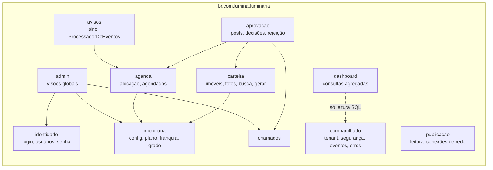
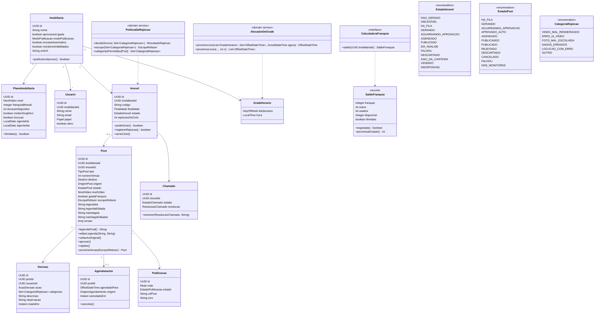
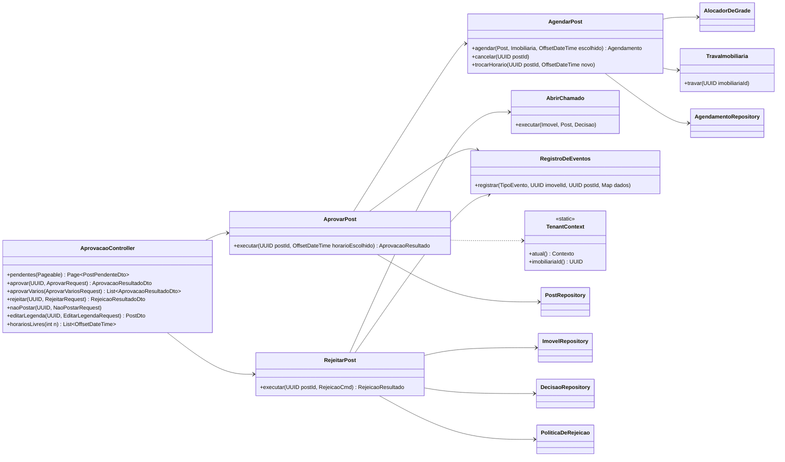
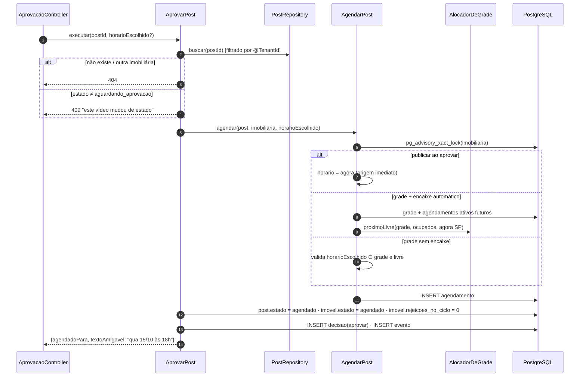
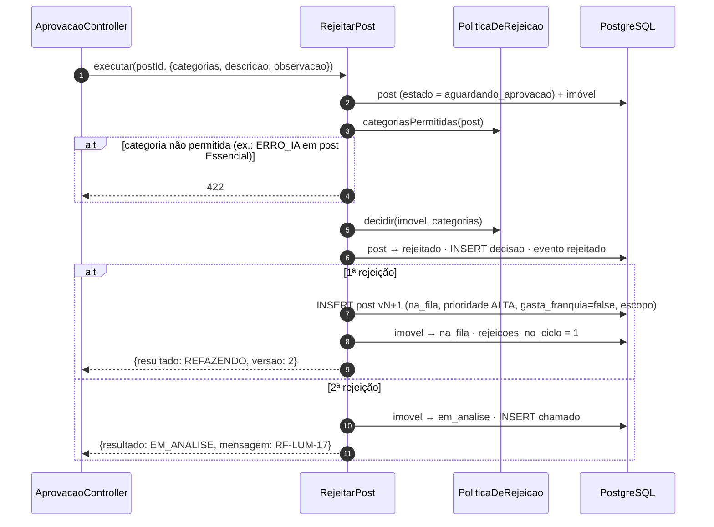

# 06 — Backend Spring Boot

Monólito modular: um deploy, módulos com fronteiras claras (verificáveis com **Spring Modulith**). A regra de negócio fica em serviços de domínio pequenos e testáveis sem banco; o resto é CRUD bem feito.

## 1. Módulos



Estrutura de cada módulo:

```
aprovacao/
├── api/            AprovacaoController, DTOs (records), mapeadores
├── aplicacao/      AprovarPost, RejeitarPost, NaoPostarImovel, EditarLegenda  (@Service @Transactional)
├── dominio/        Post, Decisao, PoliticaDeRejeicao, CategoriaRejeicao  (regras puras)
└── infra/          PostRepository, consultas nativas
```

Um caso de uso por classe (`AprovarPost.executar(...)`): fácil de achar, de testar e de mapear para o requisito.

## 2. Diagrama de classes — domínio



Outros enums (gerados de `contrato/estados.yaml`): `NivelVideo {ESSENCIAL, PRO, MAX}`, `Destino {REDES, MONITORES}`, `TipoPost {IMOVEL, VENDIDO, PROPRIO}`, `Rede {INSTAGRAM, TIKTOK, YOUTUBE}`, `ModoPublicacao {PUBLICAR_AO_APROVAR, SEGUIR_GRADE}`, `EscopoRefazer {REMONTAR, NOVAS_FOTOS, NOVOS_CLIPES, TUDO}`.

## 3. Diagrama de classes — aplicação (aba Aprovação)



`TravaImobiliaria` = `SELECT pg_advisory_xact_lock(hashtextextended(?::text, 0))`: serializa alocação de grade e conta de franquia por imobiliária, sem travar as outras.

## 4. Casos de uso

### 4.1 Aprovar (RF-LUM-11)



Grade sem encaixe automático: o front primeiro chama `GET /aprovacao/horarios-livres?n=8` e mostra a lista com o mais próximo selecionado; o POST vem com o horário escolhido. Se outro usuário pegou o horário nesse meio-tempo, o índice único devolve conflito → **409** com a próxima sugestão.

### 4.2 Alocador de grade (RN-LUM-04)

```java
public OffsetDateTime proximoLivre(List<GradeHorario> grade, Set<OffsetDateTime> ocupados, ZonedDateTime agora) {
    if (grade.isEmpty()) throw new GradeVaziaException();
    var porDia = grade.stream().collect(groupingBy(GradeHorario::diaSemana,
                     mapping(GradeHorario::hora, toCollection(TreeSet::new))));
    LocalDate dia = agora.toLocalDate();
    for (int i = 0; i < 366; i++, dia = dia.plusDays(1)) {          // "sem limite", com teto de segurança
        for (LocalTime hora : porDia.getOrDefault(dia.getDayOfWeek(), new TreeSet<>())) {
            var candidato = ZonedDateTime.of(dia, hora, SAO_PAULO);
            if (candidato.isAfter(agora) && !ocupados.contains(candidato.toOffsetDateTime()))
                return candidato.toOffsetDateTime();
        }
    }
    throw new GradeLotadaException();
}
```

Função pura: testada com tabela de casos (fim de semana, virada de mês, horário passando agora, grade cheia).

### 4.3 Rejeitar (RF-LUM-15, RN-LUM-01/02)



### 4.4 Processador de eventos (avisos)

Job `@Scheduled(fixedDelay = 5s)` + acordado por `NOTIFY lum_evento`. Roda com `TenantContext` de sistema (`admin = true`, `ator = sistema`).

| Evento lido | Ação |
|---|---|
| `video_gerado` (post `aguardando_aprovacao`) | aviso "vídeo novo para aprovar" para a imobiliária |
| `video_gerado` (post `aprovado_auto`) | `AgendarPost` com a mesma regra do botão Aprovar |
| `saiu_da_carteira` | aviso "o imóvel 669 saiu do seu sistema. Foi vendido?" |
| `publicacao_falhou` / `conexao_expirada` | aviso vermelho + alerta no Admin |
| `franquia_80` / `franquia_esgotada` | aviso (emitido uma vez por mês, chave única) |
| `chamado_resolvido` | aviso para quem rejeitou |

Mais um `@Scheduled` a cada hora: pendentes há 48 h → lembrete (RN-LUM-03), sem duplicar (chave única `tipo + post_id`).

## 5. API REST (visão geral)

Prefixo `/api/v1`, JSON, erros em `ProblemDetail`. Contrato completo virá em OpenAPI (springdoc) num documento próprio.

| Recurso | Endpoints principais | RF |
|---|---|---|
| Auth | `POST /auth/login`, `POST /auth/logout`, `GET /auth/eu`, `POST /auth/esqueci-senha`, `POST /auth/redefinir-senha` | 01, 03 |
| Aprovação | `GET /aprovacao/pendentes`, `GET /aprovacao/agendados`, `GET /aprovacao/horarios-livres`, `POST /posts/{id}/aprovar`, `POST /posts/aprovar-varios`, `POST /posts/{id}/rejeitar`, `PATCH /posts/{id}/legenda`, `GET /posts/{id}/midia` (URL assinada), `PATCH /agendamentos/{postId}`, `DELETE /agendamentos/{postId}` | 10–17 |
| Imóveis | `GET /imoveis?estado=&finalidade=&tipo=&bairro=&precoMin=&precoMax=&quartos=&q=&ordem=&pagina=`, `GET /imoveis/{id}`, `GET /imoveis/{id}/estado`, `GET /imoveis/{id}/linha-do-tempo`, `POST /imoveis/{id}/gerar`, `POST /imoveis/{id}/nao-postar`, `POST /imoveis/{id}/desfazer-descarte`, `POST /imoveis/{id}/confirmar-saida`, `PUT /imoveis/{id}/fotos-escolhidas` | 16, 18, 20–27, 30 |
| Dashboard | `GET /dashboard/resumo?de=&ate=`, `GET /dashboard/publicados-por-periodo`, `GET /dashboard/carteira-por-estado`, `GET /dashboard/ultimos-publicados` | 40–46 |
| Configurações | `GET/PUT /configuracoes/publicacao`, `GET/PUT /configuracoes/grade`, `GET /configuracoes/horarios-recomendados`, `GET/PUT /configuracoes/imobiliaria`, `GET /configuracoes/plano`, `GET /configuracoes/redes`, `GET /configuracoes/limites-legenda` | 50–55 |
| Franquia | `GET /franquia`, `GET /franquia/extrato` | 80–82 |
| Avisos | `GET /avisos`, `POST /avisos/{id}/lido`, `POST /avisos/lidos` | 70 |
| Monitores | `GET /monitores/videos` | 31 |
| Apoio às telas ([08](08-especificacao-de-telas.md)) | `GET /aprovacao/resumo`, `GET /aprovacao/agenda?dias=7`, `GET /imoveis/contagens`, `GET /posts/{id}/comparar`, `POST /monitores/videos`, `POST /auth/definir-senha` | — |
| Admin | `/admin/imobiliarias` (+ `POST` nova), `/admin/imobiliarias/{id}/ler-xml`, `/admin/publicacoes/{id}/tentar-de-novo`, `/admin/saude`, `/admin/consumo.csv`, `/admin/usuarios/{id}/reativar`, `/admin/imobiliarias/{id}/plano`, `/admin/chamados`, `/admin/chamados/{id}/resolver`, `/admin/falhas`, `/admin/falhas/{postId}/tentar-de-novo`, `/admin/consumo`, `/admin/usuarios`, `/admin/horarios-recomendados`, `/admin/imobiliarias/{id}/entrar-como` | 60–67 |

## 6. Bibliotecas

| Necessidade | Escolha |
|---|---|
| Web/validação | `spring-boot-starter-web`, `-validation` |
| Persistência | `spring-boot-starter-data-jpa` (Hibernate 6), `flyway-core` + `flyway-database-postgresql` |
| Segurança | `spring-boot-starter-security`, `spring-session-jdbc` |
| Rate limit | `bucket4j-core` |
| Módulos | `spring-modulith-starter-core` (+ teste de fronteiras) |
| Documentação da API | `springdoc-openapi-starter-webmvc-ui` (só fora de produção) |
| MinIO | `io.minio:minio` (URL assinada) |
| Observabilidade | `spring-boot-starter-actuator` (health para o EasyPanel), logs JSON |
| Testes | JUnit 5, AssertJ, Testcontainers (PostgreSQL), ArchUnit |

Sem Lombok nas entidades de domínio (records nos DTOs bastam); sem MapStruct na v1 (mapeadores manuais pequenos).
