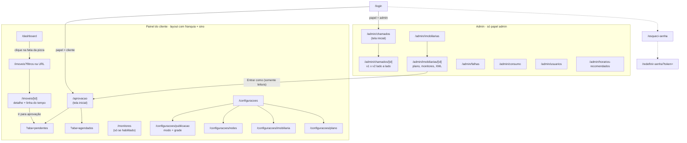
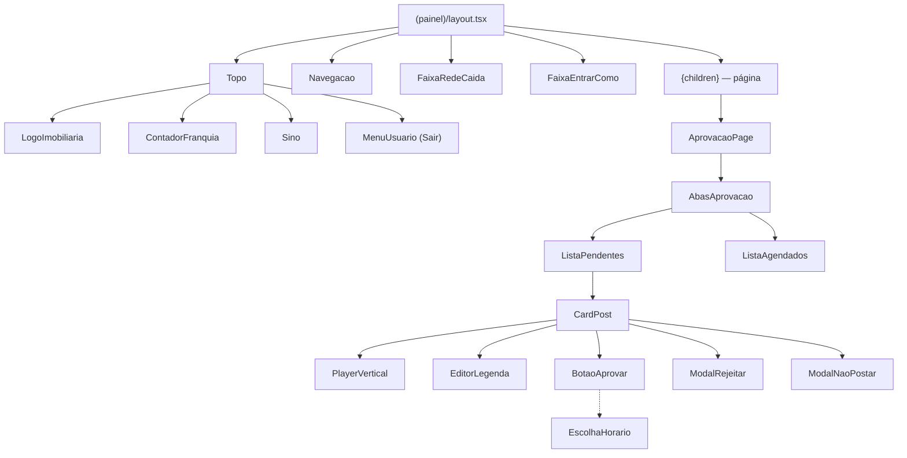
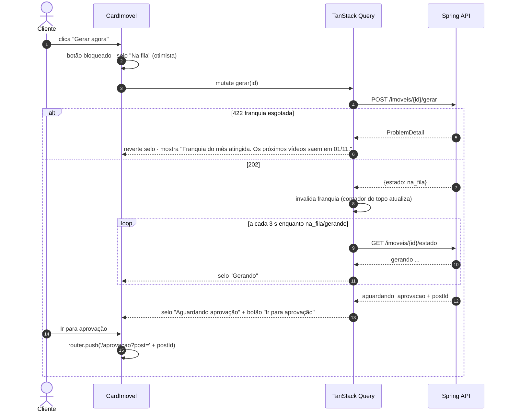

# 07 — Frontend Next.js

Painel atrás de login, usado no celular (aprovar entre uma visita e outra) e no computador. Atende RNF-LUM-01/02/06/07 e segue o UI Kit v2 Light da Lumina.

> A especificação tela a tela está no [08](08-especificacao-de-telas.md). Este documento define estrutura, dados e comportamento do frontend.

## 1. Princípios

| Princípio | Como |
|---|---|
| O Spring decide, o front mostra | Nenhuma regra de negócio no front além de validação de formulário e esconder o que o servidor já proíbe |
| Dados vêm do navegador | Componentes cliente + TanStack Query chamando `/api/v1` na mesma origem (ver [01 §5](01-arquitetura.md#5-como-o-nextjs-fala-com-o-spring)). Server Components só para casca/layout |
| Leve (RNF-LUM-01) | Abre em < 2 s no 4G; troca de aba sem recarregar; vídeo só carrega no play; Recharts carregado só no Dashboard |
| Um layout que se adapta (RNF-LUM-02) | Mobile first a partir de 360 px; navegação inferior no celular, lateral no computador |
| Tipos do contrato | Estados gerados de `contrato/estados.yaml`; tipos da API gerados do OpenAPI do Spring |

## 2. Mapa de navegação



## 3. Estrutura de pastas

```
web/
├── src/
│   ├── app/
│   │   ├── (publico)/login/page.tsx
│   │   ├── (publico)/esqueci-senha/page.tsx
│   │   ├── (publico)/redefinir-senha/page.tsx
│   │   ├── (painel)/layout.tsx              # Topo (logo, franquia, sino, usuário) + navegação
│   │   ├── (painel)/aprovacao/page.tsx
│   │   ├── (painel)/imoveis/page.tsx
│   │   ├── (painel)/imoveis/[id]/page.tsx
│   │   ├── (painel)/monitores/page.tsx
│   │   ├── (painel)/dashboard/page.tsx
│   │   ├── (painel)/configuracoes/...      
│   │   ├── admin/layout.tsx                 # guarda de papel admin
│   │   ├── admin/chamados/...
│   │   └── layout.tsx                       # fontes, QueryClientProvider, Toaster
│   ├── features/                            # um módulo por área, espelhando o backend
│   │   ├── aprovacao/  { api.ts, hooks.ts, components/ }
│   │   ├── imoveis/
│   │   ├── dashboard/
│   │   ├── configuracoes/
│   │   ├── franquia/
│   │   ├── avisos/
│   │   ├── auth/
│   │   └── admin/
│   ├── components/
│   │   ├── ui/                              # shadcn/ui vestido com o UI Kit
│   │   ├── SeloEstado.tsx
│   │   ├── PlayerVertical.tsx
│   │   └── EstadoVazio.tsx
│   ├── lib/
│   │   ├── api-client.ts                    # fetch + CSRF + ProblemDetail
│   │   ├── query-keys.ts
│   │   ├── formatos.ts                      # moeda, datas, "qua 15/10 às 18h"
│   │   └── fuso.ts                          # America/Sao_Paulo
│   ├── contrato/estados.ts                  # GERADO
│   ├── contrato/api.d.ts                    # GERADO (openapi-typescript)
│   └── middleware.ts
└── tailwind.config.ts
```

Regra: `app/` só compõe páginas; tudo que fala com a API fica em `features/<area>/api.ts` + `hooks.ts`.

## 4. Camada de dados

### 4.1 Cliente HTTP

```ts
// lib/api-client.ts
export class ApiError extends Error {
  constructor(public status: number, public problem: ProblemDetail) { super(problem.title); }
}

function csrf(): string | undefined {
  return document.cookie.split('; ').find(c => c.startsWith('XSRF-TOKEN='))?.split('=')[1];
}

export async function api<T>(caminho: string, init: RequestInit = {}): Promise<T> {
  const metodo = (init.method ?? 'GET').toUpperCase();
  const res = await fetch(`/api/v1${caminho}`, {
    ...init,
    credentials: 'same-origin',
    headers: {
      'Content-Type': 'application/json',
      ...(metodo !== 'GET' && { 'X-XSRF-TOKEN': decodeURIComponent(csrf() ?? '') }),
      ...init.headers,
    },
  });
  if (res.status === 401) { window.location.href = '/login?expirou=1'; throw new ApiError(401, { title: 'Sessão expirada' }); }
  if (!res.ok) throw new ApiError(res.status, await res.json());
  return res.status === 204 ? (undefined as T) : res.json();
}
```

Tratamento padrão de erro (num `QueryCache`/`MutationCache` global):

| Status | Comportamento |
|---|---|
| 401 | Volta ao login |
| 404 | "Não encontrado" (também é o que um recurso de outra imobiliária devolve) |
| 409 | Toast "Este vídeo mudou de estado" + invalida as consultas da tela |
| 422 | Mensagem do `ProblemDetail.detail` no formulário (ex.: franquia esgotada) |
| 5xx / rede | Toast "Não conseguimos falar com o servidor" + botão tentar de novo |

### 4.2 Chaves de consulta

```ts
export const qk = {
  eu:            ['eu'] as const,
  franquia:      ['franquia'] as const,
  avisos:        ['avisos'] as const,
  pendentes:     ['aprovacao', 'pendentes'] as const,
  agendados:     ['aprovacao', 'agendados'] as const,
  imoveis:       (f: FiltrosImoveis) => ['imoveis', f] as const,
  imovel:        (id: string) => ['imovel', id] as const,
  estadoImovel:  (id: string) => ['imovel', id, 'estado'] as const,
  dashboard:     (p: Periodo) => ['dashboard', p] as const,
};
```

### 4.3 Atualização automática (sem WebSocket)

| Dado | Intervalo | Quando |
|---|---|---|
| Pendentes (RF-LUM-10 "se atualiza sozinha") | 30 s | aba visível |
| Contador de pendentes no menu + sino | 60 s | sempre |
| Estado de um imóvel em `na_fila`/`gerando` | 3 s | **só** enquanto houver imóvel nesses estados na tela; para sozinho depois |
| Franquia (topo) | ao focar a janela + após gerar | — |
| Demais | sem polling; `refetchOnWindowFocus` | — |

```ts
// features/imoveis/hooks.ts
export function useEstadoImovel(id: string, estadoInicial: EstadoImovel) {
  return useQuery({
    queryKey: qk.estadoImovel(id),
    queryFn: () => api<{ estado: EstadoImovel; postId?: string }>(`/imoveis/${id}/estado`),
    initialData: { estado: estadoInicial },
    refetchInterval: (q) => EM_PRODUCAO.has(q.state.data.estado) ? 3000 : false,
  });
}
```

### 4.4 Mutações e atualização otimista

- **Aprovar**: *não* otimista — o cliente precisa ver o horário que o servidor escolheu ("Agendado para qua 15/10 às 18h"). Botão em estado de carregamento; ao responder, o card sai da lista com animação e aparece o toast com o horário.
- **Editar legenda**: otimista (o texto já está na tela), com reversão em erro.
- **Gerar agora**: otimista no selo (`na_fila`) e botão bloqueado; em erro 422 (franquia), volta e mostra a mensagem da RF-LUM-81.
- Após qualquer mutação de post: invalidar `pendentes`, `agendados`, `franquia`, `imovel(id)`.

## 5. Telas → componentes → API

### 5.1 Aprovação (RF-LUM-10 a 18)

Layout **mestre-detalhe**. No desktop, a fila fica à esquerda e o vídeo selecionado à direita; no celular, a fila ocupa a tela e o detalhe abre por cima (`?post={id}`).

| Componente | Faz | Endpoint |
|---|---|---|
| `AbasAprovacao` | Pendentes / Agendados com contadores; aba na URL | — |
| `FaixaModoPublicacao` | "Seguindo a grade, com encaixe automático. Próximo horário livre: sex 16/10 às 18h · Alterar" | `GET /aprovacao/resumo` |
| `FaixaSaiuDaCarteira` | Pergunta "foi vendido ou alugado?" no topo da aba | `GET /imoveis?estado=saiu_da_carteira` |
| `ListaPendentes` | Mais antigo primeiro, com seleção múltipla e selos (Há N dias, Lembrete 48 h, Refeito · Nª versão, Voltou da análise, Post Vendido); "Nada para aprovar" + atalho para o Dashboard quando vazia | `GET /aprovacao/pendentes` |
| `DetalhePendente` | Player, "Comparar com a 1ª versão", caixa da rejeição anterior (quem, quando, motivo e o que mudou), cartões de dados, legenda, hashtags, "Vai para" | `GET /posts/{id}/comparar` |
| `CalendarioSeteDias` | Agendados: horários da grade por dia, ocupados ou livres | `GET /aprovacao/agenda?dias=7` |
| `CardPost` | Player 9:16, dados do imóvel, "esperando desde", selo "Refeito (2ª versão)" com motivo anterior, redes de destino | — |
| `PlayerVertical` | `<video preload="none" poster=capa>`; URL assinada pedida só no play | `GET /posts/{id}/midia` |
| `EditorLegenda` | Legenda e hashtags separadas, contador por rede, "Voltar ao original" | `PATCH /posts/{id}/legenda` |
| `BotaoAprovar` | Conforme modo: aprova direto ou abre `EscolhaHorario` | `POST /posts/{id}/aprovar` |
| `EscolhaHorario` | Próximos horários livres, o primeiro selecionado | `GET /aprovacao/horarios-livres` |
| `ModalRejeitar` | Categorias em botões grandes (filtradas pelo nível do post), descrição (obrigatória em "Outro"), observação; mensagem RF-LUM-17 na 2ª | `POST /posts/{id}/rejeitar` |
| `ModalNaoPostar` | Motivo curto | `POST /imoveis/{id}/nao-postar` |
| `PerguntaVendido` | "O imóvel 669 saiu do seu sistema. Foi vendido ou alugado?" | `POST /imoveis/{id}/confirmar-saida` |
| `SelecaoMultipla` + `BarraAprovarVarios` | Seleciona e aprova vários em sequência (Média) | `POST /posts/aprovar-varios` |
| `ListaAgendados` | Ordem de horário; trocar horário, cancelar | `PATCH`/`DELETE /agendamentos/{postId}` |

`?post={id}` na URL abre a aba já posicionada naquele vídeo (botão "Ir para aprovação" da RF-LUM-24).

Limites de caracteres por rede: vêm de `GET /configuracoes/limites-legenda` (o servidor é a fonte única; os valores ficam em configuração e acompanham a documentação de cada rede, RF-LUM-14).

### 5.2 Imóveis (RF-LUM-20 a 27)

| Componente | Faz | Endpoint |
|---|---|---|
| `BarraBusca` | Debounce 300 ms; código, sem acento, erro de digitação | `GET /imoveis?q=` |
| `Filtros` | Estado, finalidade, tipo, bairro, preço, quartos, ordenação — **tudo na URL** (`nuqs`) | `GET /imoveis?...` |
| `ChipsSituacao` | Um chip por estado com a contagem ("Não gerados 41") + "Copiar link desta busca" | `GET /imoveis/contagens` |
| `GradeImoveis` | Cards com miniatura (`loading="lazy"`), paginação por "carregar mais" | — |
| `CardImovel` | Capa, selos (estado, finalidade, versão), código, tipo, bairro, preço ("/mês" na locação, "cond." quando houver), quartos, banheiros, vagas, área | — |
| `RodapeCardImovel` | **Muda com o estado** (tabela no [08 §2.6](08-especificacao-de-telas.md#26-imóveis--catálogo)): Gerar agora + só vitrine, "2º da vez", barra "uns 3 min", Ir para aprovação, horário agendado, Foi vendido?, Gerar de novo, mensagens de análise/erro/inelegível | `POST /imoveis/{id}/gerar` |
| `DetalheImovel` | Fotos, dados, versões com player, publicações por rede com link | `GET /imoveis/{id}` |
| `LinhaDoTempo` | Detectado, gerado, rejeitado por fulano (motivo), refeito, aprovado, agendado, publicado | `GET /imoveis/{id}/linha-do-tempo` |
| `GerarDeNovo` | Confirmação "já publicado em 12/09" + destino (redes / só monitores) | `POST /imoveis/{id}/gerar` |
| `EscolherFotos` | Marcar fotos antes de gerar (Média) | `PUT /imoveis/{id}/fotos-escolhidas` |

### 5.3 Dashboard (RF-LUM-40 a 46)

`SeletorPeriodo` (na URL) → `CartoesResumo`, `GraficoPublicados` (barras por rede, dia/mês), `PizzaCarteira` (clique → `/imoveis?estado=...`), `UltimosPublicados`, `TempoEconomizado`. Recharts via `next/dynamic` para não pesar nas outras telas.

### 5.4 Configurações (RF-LUM-50 a 55)

Sem botão Salvar: cada campo grava ao mudar (mutação com debounce de 600 ms nos textos) e o topo mostra "Alterações salvas automaticamente". `ModoPublicacao` (rádio + caixa "Encaixar automaticamente"), `EditorGrade` (dias × horários, recomendados destacados, botão "Usar horários recomendados"), `AprovacaoLigada` (com confirmação ao desligar), `Redes` (estado de cada conexão), `DadosImobiliaria`, `PlanoAtual` (somente leitura + "Para mudar de plano, fale com a Lumina").

### 5.5 Elementos globais (layout do painel)

| Componente | Requisito |
|---|---|
| `ContadorFranquia` — "Vídeos do mês: 23 de 30 · +5 do mês passado"; clique abre o extrato; oculto no Ilimitado | RF-LUM-80 |
| `Sino` — contador + lista de avisos, marcar como lido | RF-LUM-70 |
| `FaixaRedeCaida` — vermelha em todas as telas: "Reconecte o Instagram para voltar a publicar" | RF-LUM-53 |
| `FaixaEntrarComo` — "Você está vendo como <imobiliária> · Sair" | RF-LUM-66 |
| `Navegacao` — lateral no computador (cartão da imobiliária, menu com badge de pendentes e total de imóveis, rodapé "Publicando em" com o status das redes); inferior no celular (Aprovação, Imóveis, Dashboard, Mais) | RNF-LUM-02 |
| `MenuUsuario` — nome, cargo e Sair | RF-LUM-01 |



## 6. Fluxo "Gerar agora" no front



## 7. Autenticação e guardas

- `middleware.ts`: sem cookie `SESSION` → `/login`. Só isso; a verdade é o Spring.
- `(painel)/layout.tsx` busca `GET /auth/eu` (nome, papel, imobiliária, monitores habilitados, nível do plano) e coloca num contexto. Itens de menu (Monitores, categorias de rejeição) dependem dele, mas o servidor também barra.
- `admin/layout.tsx`: papel ≠ admin → 404.
- Logout: `POST /auth/logout` → `queryClient.clear()` → `/login`. Limpar o cache impede que dados de uma conta apareçam depois de entrar em outra no mesmo aparelho.

## 8. Identidade visual (RNF-LUM-06)

```ts
// tailwind.config.ts (trecho)
theme: {
  extend: {
    colors: {
      primaria: { DEFAULT: '#0EA5E9', escura: '#0284C7', clara: '#E0F2FE' },
      fundo: '#F8FCFF',
      cartao: '#FFFFFF',
      estado: {                          // gerado junto de contrato/estados.ts
        nao_gerado: '#94A3B8', na_fila: '#A78BFA', gerando: '#8B5CF6',
        aguardando_aprovacao: '#F59E0B', agendado: '#0EA5E9', publicado: '#10B981',
        em_analise: '#F97316', falhou: '#EF4444', descartado: '#64748B',
        saiu_da_carteira: '#EAB308', vendido: '#059669', indisponivel: '#CBD5E1', inelegivel: '#CBD5E1',
      },
    },
    borderRadius: { cartao: '16px', destaque: '24px' },
    boxShadow: { cartao: '0 4px 20px -6px rgb(14 165 233 / 0.18)' },
    fontFamily: { titulo: ['var(--font-space-grotesk)'], corpo: ['var(--font-inter)'] },
  },
}
```

Fontes com `next/font/google` (Space Grotesk e Inter, `display: 'swap'`, subconjunto `latin`). As cores de estado são tokens do tema e podem ser ajustadas sem mudar componentes.

## 9. Brasil (RNF-LUM-07)

- `Intl.NumberFormat('pt-BR', { style: 'currency', currency: 'BRL' })`, datas `dd/mm/aaaa`.
- Tudo exibido no fuso `America/Sao_Paulo` (`date-fns-tz`), independentemente do fuso do aparelho. A API trafega `OffsetDateTime` ISO-8601.
- Textos em um arquivo por área (`features/*/textos.ts`); sem biblioteca de i18n na v1.

## 10. Bibliotecas

| Necessidade | Escolha |
|---|---|
| Framework | Next.js (App Router) + TypeScript estrito, `output: 'standalone'` para o Docker |
| Dados | `@tanstack/react-query` |
| Estado na URL | `nuqs` |
| UI | Tailwind + shadcn/ui + `lucide-react` |
| Formulários | `react-hook-form` + `zod` |
| Gráficos | `recharts` (import dinâmico) |
| Datas | `date-fns` + `date-fns-tz` |
| Tipos da API | `openapi-typescript` a partir do `/v3/api-docs` do Spring |
| Testes | Vitest + Testing Library + MSW; Playwright e2e em viewport 360×800 e 1440×900 |

## 11. Critérios de pronto por tela

- [ ] Funciona em 360 px sem rolagem horizontal e no desktop.
- [ ] Estados de carregamento (skeleton), vazio e erro desenhados.
- [ ] Nenhum vídeo baixado antes do play (verificado na aba Network do navegador).
- [ ] Filtros e abas sobrevivem a recarregar a página (estão na URL).
- [ ] Teclado e leitor de tela: botões com rótulo, foco visível, modais com `aria-modal`.
- [ ] Teste e2e do fluxo principal da tela passando nos dois viewports.
