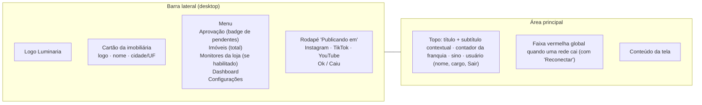

# 08 — Especificação de telas

Comportamento de cada tela do painel e o que cada uma exige do backend. A estrutura do frontend (rotas, componentes, camada de dados) está no [07](07-frontend-nextjs.md); os contratos da API, no [06](06-backend-spring.md).

Os exemplos de texto usam dados fictícios.

## 1. Layout geral

### 1.1 Área do cliente

| Elemento | Regra |
|---|---|
| Status das redes | Sempre visível no rodapé da barra lateral, a partir de `conexao_rede` |
| Contador da franquia | "Vídeos do mês: 23 de 30 · +5 do mês passado"; clique abre o extrato; oculto no plano ilimitado (RF-LUM-80) |
| Usuário | Nome, **cargo** (`usuario.cargo`) e Sair |
| Subtítulos | Calculados pelo servidor: "7 vídeos esperando você · o mais antigo há 3 dias", "286 imóveis na carteira · lidos do seu sistema hoje às 08h00" |
| Celular | Barra lateral substituída por navegação inferior (Aprovação, Imóveis, Dashboard, Mais) — ver [07](07-frontend-nextjs.md) |

### 1.2 Área do Admin

Mesma estrutura, com selo **ADMIN**, cartão "Todas as imobiliárias · N ativas · visão global" e menu Chamados (badge), Imobiliárias, Falhas e saúde (badge), Consumo e Usuários.

## 2. Telas do cliente

### 2.1 Login

Duas colunas: à esquerda, a mensagem do produto com peças 9:16 de exemplo; à direita, e-mail, senha (mostrar/ocultar) e "Esqueci a senha". Abaixo: "Você continua conectado neste aparelho por 30 dias" e "Não tem acesso? Peça à equipe Lumina".

### 2.2 Aprovação · Pendentes (mestre-detalhe)

| Área | Conteúdo | Exige |
|---|---|---|
| Faixa de modo | "Seguindo a grade, com encaixe automático. Próximo horário livre: sex 16/10 às 18h · Alterar" | `GET /aprovacao/resumo` |
| Faixa "Saiu da carteira" | "O imóvel 669 saiu do seu sistema. Ele foi vendido ou alugado?" + "Sim, foi vendido" / "Não, só foi retirado" | imóveis em `saiu_da_carteira` |
| Fila (esquerda) | Seleção múltipla; miniatura, título, COD · finalidade · bairro, preço; selos **Há N dias**, **Lembrete: mais de 48 h**, **Refeito · Nª versão**, **Voltou da análise**, **Post Vendido** | `esperandoDesde`, `numeroVersao`, `voltouDaAnalise`, `tipo` |
| Detalhe (direita) | Player 9:16 com selo de versão; **Comparar com a versão anterior** | `GET /posts/{id}/comparar` |
| Rejeição anterior | "Você rejeitou a 1ª versão em seg 12/10 (nome do usuário). Foto mal escolhida: '…' Observação: '…' A 2ª versão usa outras fotos." | decisão anterior + texto derivado de `escopo_refazer` |
| Dados | Venda (com condomínio), Quartos (suítes), Banheiros, Vagas, Área | `preco_condominio`, `suites` |
| Legenda | Selo "Escrita pela IA" (some quando editada); contador único "871 caracteres · Dentro do limite das 3 redes" | limite efetivo = menor limite entre as redes ativas |
| Hashtags | Campo separado, com contagem | — |
| Ações | "Vai para: Instagram Reels · TikTok · YouTube Shorts"; **Aprovar — "Vai para sex 16/10 às 18h"**; Rejeitar; Não postar | o botão mostra o horário antes do clique |

### 2.3 Aprovação · Agendados

- Cabeçalho: "5 vídeos aprovados esperando o horário · o próximo sai hoje às 12h" e o resumo da grade com **Editar grade**.
- **Próximos 7 dias**: por dia, os horários da grade marcados como *agendado* (com o imóvel) ou *livre*; dia sem grade mostra "Sem horários na grade" (`GET /aprovacao/agenda?dias=7`).
- Lista agrupada por dia (Hoje, Amanhã…): hora, tempo relativo, imóvel, origem (**Encaixe automático** / **Escolhido na aprovação**), quem aprovou e quando, "legenda editada".
- Ações: Editar legenda, Trocar horário, Cancelar agendamento.

### 2.4 Janelas da aprovação

| Janela | Comportamento |
|---|---|
| **Rejeitar vídeo** | Categorias em cartões com descrição: Vídeo mal renderizado · Erro da IA no vídeo (só Pro/Max) · Foto mal escolhida · Dados errados · **Locução com erro** (só com o acessório Locução) · Outro. Descrição (obrigatória em "Outro") e observação. Quando for a 2ª rejeição, a janela avisa **antes** de confirmar, explica "O que acontece agora" e o botão vira "Rejeitar e enviar para análise". |
| **Enviado para a equipe técnica** | Confirmação da 2ª rejeição, com o imóvel e "Chamado aberto em qua 14/10 às 10h41" (RF-LUM-17). |
| **Quando publicar?** | Próximos horários livres com selos **Mais próximo** e **Recomendado**; "Mostrar mais horários"; o botão confirma com a data ("Aprovar para sex 16/10 às 18h"). |
| **Não postar este imóvel** | Motivos em chips (Já foi vendido ou alugado · Proprietário não autorizou · Não combina com a marca · Outro motivo) + texto curto. |

### 2.5 Sino

Lista com ícone por tipo, ponto de não lido, tempo relativo e "Marcar todos como lidos". Tipos: rede desconectou · vídeo novo para aprovar · lembrete de 48 h · saiu da carteira · chamado resolvido (com a versão) · publicação falhou numa rede ("as outras redes saíram normalmente") · franquia em 80% · franquia esgotada.

### 2.6 Imóveis · Catálogo

- Busca por código, bairro sem acento, erro de digitação ou pedaço de palavra.
- Chips de **Situação com a contagem de cada estado** (`GET /imoveis/contagens`).
- Filtros (Finalidade, Tipo, Bairro, Preço, Quartos), ordenação e **Copiar link desta busca**; "Mostrando 16 de 286".
- Card: foto, selos (estado, finalidade, versão), COD · tipo, título, bairro, preço ("/mês" na locação; "cond." quando houver), quartos, banheiros, vagas, área.
- O **rodapé do card depende do estado**:

| Estado | Rodapé |
|---|---|
| `nao_gerado` | **Gerar agora** + botão de ícone "só para os monitores" (se habilitado); bloqueado com a mensagem da RF-LUM-81 quando a franquia acabou |
| `na_fila` | "Na fila · 2º da vez" |
| `gerando` | Barra de progresso "Gerando o vídeo · uns 3 min" |
| `aguardando_aprovacao` | **Ir para aprovação** |
| `agendado` | "qua 14/10 às 12h" + Ver agendados |
| `saiu_da_carteira` | "Sumiu do seu sistema ontem" + **Foi vendido?** |
| `publicado` | "Publicado em 09/10" + ícones das redes + **Gerar de novo** |
| `em_analise` | "Com a equipe técnica da Lumina desde 12/10" |
| `falhou` | "Erro ao gerar. A equipe Lumina já foi avisada." |
| `inelegivel` | O motivo, ex.: "Só 3 fotos. O mínimo é 4." |
| `descartado` | "Você escolheu não postar" + Desfazer |
| `vendido` / `indisponivel` | Data da saída da carteira |

### 2.7 Imóveis · Detalhe

- Cabeçalho com selos, **Ver no Instagram** e **Gerar nova versão**.
- **Fotos**: total no sistema; marcador "Usada na vN"; "Escolher fotos do próximo vídeo" (sem marcação, o sistema escolhe).
- **Versões do vídeo** lado a lado: data, nível, número de fotos, quem aprovou/rejeitou e o motivo, "Legenda editada antes de aprovar".
- **Publicações da vN** por rede: horário, atraso ("saiu 6 min depois do horário"), Abrir post, falha explicada.
- **Dados do imóvel**: Venda, Condomínio, Quartos, Banheiros, Vagas, Área privativa, Bairro, Empreendimento; "Lidos do seu sistema hoje às 08h00".
- **Linha do tempo** com textos explicativos.

### 2.8 Gerar nova versão

Destino ("Publicar de novo nas redes" ou "Só para os monitores"), nota sobre a escolha de fotos e o consumo: **"Vai usar 1 vídeo da franquia (23 de 30)"** (RN-LUM-13). Botão "Gerar a v3". Com a franquia esgotada, o botão fica bloqueado com a mensagem da RF-LUM-81.

### 2.9 Monitores da loja

Visível só para imobiliárias com monitores habilitados. "8 vídeos passando nos monitores da loja. Eles não vão para as redes." Botão **Mandar um imóvel para os monitores**. Grade de peças 9:16 com "Nos monitores desde ter 13/10 · Pedido por <usuário>".

O nome "Vitrine de imóveis" é reservado ao catálogo (aba Imóveis), como no material comercial.

### 2.10 Dashboard

- Períodos: Hoje, 7 dias, 30 dias, Este mês, Mês passado, Personalizado.
- Cartões: Publicados · Aguardando · Agendados ("o próximo sai hoje às 12h") · Rejeitados · Cobertura ("197 de 257 imóveis disponíveis com vídeo publicado").
- Barras empilhadas por rede, por dia ou por mês, com **Ver tabela**.
- Tempo economizado, com a conta explicada ("20 vídeos × 20 min").
- Carteira em rosca com legenda e percentuais; estados pequenos agrupados em "Outros"; clique filtra o catálogo.
- Últimos publicados com selo por rede (inclusive falha) e "Ver todos".

### 2.11 Configurações

- **Salvamento automático**: cada campo grava ao mudar; o topo mostra "Alterações salvas automaticamente".
- Aprovação ligada (toggle) com a janela "Desligar a aprovação?" (ação principal: Manter ligada).
- Quando publicar (Publicar ao aprovar / Seguir a grade) + "Encaixar automaticamente no próximo horário da grade".
- **Grade**: colunas por dia; chip por horário (clique remove); "+ hora" adiciona; estrela = recomendado; borda tracejada = recomendado fora da grade; total por semana; horário de Brasília.
- Redes com estado e Reconectar; Dados da imobiliária (logo, nome, telefone/WhatsApp).
- **Plano** (somente leitura): nível (Essencial, Pro ou Max), faixa (vídeos por mês ou ilimitado), duração do vídeo, acessórios (Motion Graphics, Locução por IA), monitores da loja; "Para mudar de plano, fale com a Lumina".

## 3. Telas do Admin

| Tela | Conteúdo | Exige |
|---|---|---|
| **Chamados** (inicial) | Abas Abertos/Resolvidos; lista com imobiliária, idade, nº do chamado, categorias. Detalhe: as duas versões lado a lado com o que foi usado e os motivos; "Entrar como a imobiliária"; **Resolver**: Refazer com ajuste (trocar fotos, prompt de movimento, corrigir um dado: campo + valor) · Devolver para aprovação · Descartar com explicação; **Nota para o cliente** enviada no aviso | `chamado.numero`, `chamado.nota_cliente`, `post.ajustes` |
| **Imobiliárias** | Faixa de alertas; tabela com plano, franquia usada, aprovação, modo, redes, monitores, pendentes, agendados, publicados no mês, último XML (destacado se atrasado), chamados; **Nova imobiliária**; Horários recomendados | `POST /admin/imobiliarias` |
| **Detalhe da imobiliária** | CRECI; Entrar como; **Plano** (nível, faixa, duração, acessórios); monitores da loja; **fluxo de automação**; URL do XML + **Ler agora** com o resultado da última leitura; **limites técnicos** (fotos por vídeo, vídeos gerados por dia, "Gerar agora" por dia); **instruções da legenda** (voz da marca e chamada para ação / nunca escrever); painéis Agora, Escolhas do cliente, Usuários; **Salvar/Descartar** explícitos | ver §4 |
| **Horários recomendados** | Tabela global; "Salvar para todas"; não altera grades já montadas | `PUT /admin/horarios-recomendados` |
| **Falhas e saúde** | Alertas por imobiliária: rede desconectada, XML sem atualizar há mais de 24 h (Ler XML agora), fila parada, worker parado; tabela "Com problema" com abas Geração/Publicação, **etapa**, erro em linguagem simples, Tentar de novo | `post.etapa_erro`, retry por rede |
| **Consumo** | Mês, **Exportar CSV**; por imobiliária: franquia do plano, sobra do mês anterior, vídeos que gastaram franquia, gerados "agora", só para os monitores, refeitos (sem custo de franquia), publicados; destaque para quem está perto de esgotar e para quem tem muito refeito | `GET /admin/consumo.csv` |
| **Usuários** | Filtro por imobiliária e Admins; último acesso; Redefinir senha; Desativar/Reativar; Novo usuário (nome, e-mail, tipo de acesso, imobiliária) com **convite por e-mail** para criar a senha | convite por e-mail |

## 4. Requisitos técnicos derivados das telas

### 4.1 Banco ([04](04-banco-de-dados.md))

| Tabela | Campos |
|---|---|
| `usuario` | `cargo` |
| `imobiliaria` | `cidade`, `uf`, `creci`, `legenda_voz_marca`, `legenda_nunca_escrever`, `limite_fotos_por_video`, `limite_videos_por_dia`, `limite_gerar_agora_por_dia`, `ingestao_solicitada_em`, `token_monitores`, `fluxo_id` |
| `imovel` | `suites`, `preco_condominio`, `area_privativa`, `empreendimento` |
| `post` | `etapa_erro`, `erro_amigavel`, `previsao_fim`, `adicionado_monitores_por` |
| `decisao` | `motivo_categoria` (Não postar) |
| `publicacao` | `erro_amigavel` |
| `chamado` | `numero` (sequência global), `nota_cliente` |
| `token_usuario` | `tipo` = `convite` ou `redefinicao` |

### 4.2 Integração ([02](02-integracao-java-python.md))

| Comando | Painel grava | Fábrica reage |
|---|---|---|
| **Ler XML agora** | `imobiliaria.ingestao_solicitada_em = now()` → `NOTIFY lum_ingestao` | O ingestor lê aquela imobiliária na hora e zera o campo |
| **Tentar de novo uma rede** | `publicacao.estado = 'pendente'`, `tentativas = 0` | O publicador republica só aquela rede |

A fábrica grava `post.previsao_fim`, `post.etapa_erro` e as mensagens `erro_amigavel`. O alerta "fila parada" é calculado no painel: há post em `na_fila` há mais de 2 h **e** nenhum post saiu de `gerando` nesse intervalo.

### 4.3 API ([06](06-backend-spring.md))

| Endpoint | Tela |
|---|---|
| `GET /aprovacao/resumo` | Faixa de modo, próximo horário livre, rótulo do botão Aprovar |
| `GET /aprovacao/agenda?dias=7` | Próximos 7 dias em Agendados |
| `GET /imoveis/contagens` | Chips de situação |
| `GET /posts/{id}/comparar` | Comparar com a versão anterior |
| `GET /franquia`, `GET /franquia/extrato` | Contador e extrato da franquia |
| `POST /monitores/videos` | Mandar um imóvel para os monitores |
| `POST /admin/imobiliarias` | Nova imobiliária |
| `POST /admin/imobiliarias/{id}/ler-xml` | Ler agora |
| `POST /admin/publicacoes/{id}/tentar-de-novo` | Tentar de novo por rede |
| `GET /admin/consumo.csv?mes=` | Exportar CSV |
| `GET /admin/saude` | Alertas de Falhas e saúde |
| `POST /admin/usuarios/{id}/reativar` | Reativar usuário |
| `POST /auth/definir-senha` | Primeiro acesso pelo convite |
