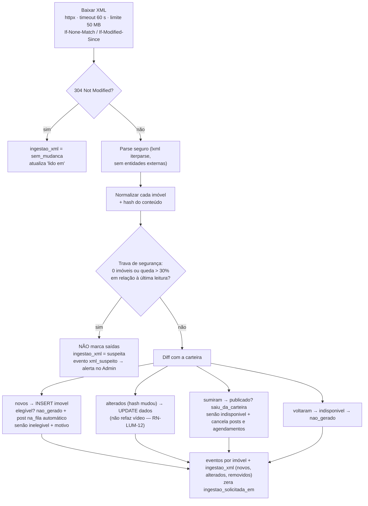
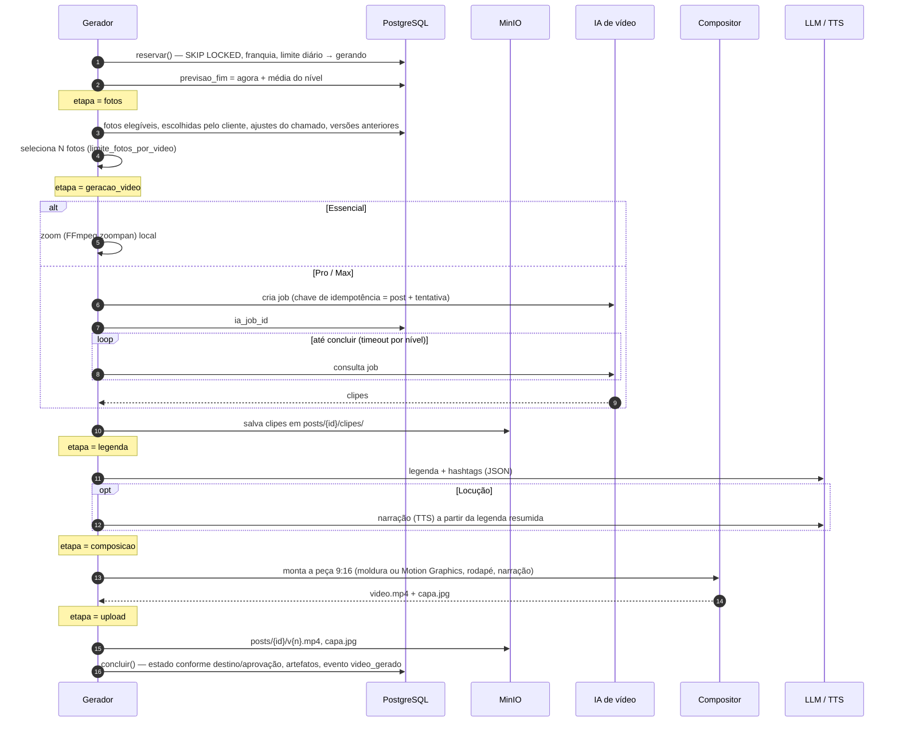
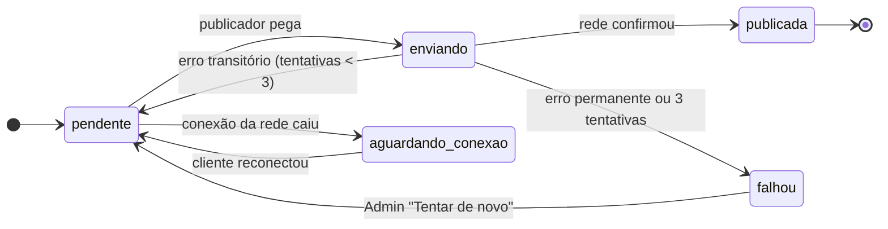

# 09 — Fábrica Python (workers)

A fábrica faz todo o trabalho pesado: lê o XML, gera o vídeo, escreve a legenda e publica. Ela conversa com o painel **só pelo banco** (ver [02](02-integracao-java-python.md)). Este documento detalha o que acontece dentro dela.

## 1. Visão geral

```mermaid
flowchart TB
    subgraph fabrica["Imagem única: python -m fabrica &lt;papel&gt;"]
        direction TB
        subgraph ing["ingestor"]
            i1["agenda por imobiliária<br/>+ 'Ler agora'"] --> i2["baixa XML"] --> i3["parse VivaReal"] --> i4["normaliza + diff por hash"] --> i5["grava imóveis, fotos,<br/>saídas da carteira, fila automática"]
        end
        subgraph ger["gerador (N réplicas)"]
            g1["reserva post na_fila<br/>(SKIP LOCKED + franquia)"] --> g2["fotos"] --> g3["clipes<br/>(Essencial / Pro / Max)"] --> g4["acessórios<br/>(motion, locução)"] --> g5["composição"] --> g6["legenda IA"] --> g7["upload + conclusão"]
        end
        subgraph pub["publicador"]
            p1["agendados vencidos<br/>+ republicações"] --> p2["uma linha por rede"] --> p3["Instagram · TikTok · YouTube<br/>(independentes)"] --> p4["resultado por rede"]
        end
        subgraph jobs["jobs de manutenção (no processo do gerador)"]
            j1["reaper 5 min"]
            j2["fechamento da franquia<br/>dia 1, 00:05"]
            j3["heartbeat 30 s"]
            j4["limpeza de mídia órfã<br/>semanal"]
        end
    end

    db[("PostgreSQL")]
    minio[("MinIO")]
    comp["compositor<br/>(FFmpeg, existente)"]
    ext["IA de vídeo · LLM · TTS<br/>Meta · TikTok · YouTube"]

    ing & ger & pub & jobs <--> db
    ger --> minio & comp & ext
    pub --> minio & ext
```



**Decisões de base**

| Decisão | Motivo |
|---|---|
| Código **síncrono**, um item por vez por processo; concorrência = mais réplicas | O gargalo é a IA externa (minutos por clipe), não o Python. Síncrono é mais simples de ler, testar e depurar |
| Jobs com APScheduler **dentro** do processo, protegidos por `pg_try_advisory_lock` | Sem cron externo; com duas réplicas, só uma roda cada job |
| SQL explícito com psycopg 3, sem ORM | O schema é do Flyway; o Python não modela o banco, só o usa |
| Cada etapa externa atrás de um `Protocol` | Gerador ou rede nova = uma classe nova |
| Etapas montadas a partir do **fluxo da imobiliária** | Clientes com automação diferente sem mudar o código comum ([11](11-fluxos-de-automacao.md)). As etapas descritas aqui são as do fluxo `padrao` |

## 2. Configuração e arranque

```python
# fabrica/config.py
class Config(BaseSettings):
    model_config = SettingsConfigDict(env_prefix="LUM_")
    database_url: PostgresDsn            # role luminaria_worker
    minio_endpoint: str
    minio_bucket: str = "luminaria"
    minio_url_publica: AnyHttpUrl        # https://<domínio>/media — as redes baixam o vídeo daqui
    chave_tokens: SecretStr              # AES-256-GCM, a mesma do Spring
    compositor_url: AnyHttpUrl
    ia_video_pro_api_key: SecretStr | None = None    # provedor do nível Pro
    ia_video_max_api_key: SecretStr | None = None    # provedor do nível Max
    llm_api_key: SecretStr
    tts_api_key: SecretStr | None = None
    worker_id: str = Field(default_factory=lambda: f"{socket.gethostname()}-{os.getpid()}")
    max_tentativas: int = 3
```

Ao subir, cada papel: valida a configuração → `checar_schema()` (ver [02 §2](02-integracao-java-python.md#2-o-contrato)) → registra o heartbeat → começa o laço. Configuração inválida ou schema incompatível = o processo sai com erro e o Docker não o marca como saudável.

## 3. Ingestor

### 3.1 Quando roda

- Para cada imobiliária ativa com `xml_url`, a cada **60 min**, espalhadas no tempo (`hash(imobiliaria_id) % 60` define o minuto) para não baixar todos os XMLs juntos.
- Na hora, quando `imobiliaria.ingestao_solicitada_em` é preenchido ("Ler agora" do Admin) — acordado por `NOTIFY lum_ingestao`.
- Uma imobiliária por vez, com `pg_try_advisory_lock(imobiliaria)` para não ler o mesmo XML duas vezes.

### 3.2 Fluxo



A **trava de segurança** existe porque um XML quebrado ou vazio (sistema da imobiliária fora do ar, exportação pela metade) marcaria a carteira inteira como "saiu da carteira" e encheria o sino do cliente de perguntas "foi vendido?". Nesse caso a ingestão não altera nada e a Lumina é avisada.

### 3.3 Mapeamento VivaReal → `imovel`

> Base: o formato de XML VivaReal usado pelos portais. Os sistemas de imobiliária variam nos campos opcionais; diferenças por cliente são tratadas com `mapa_campos` no fluxo ([11](11-fluxos-de-automacao.md)).

| VivaReal | `imovel` | Observação |
|---|---|---|
| `ListingID` | `codigo` | Chave por imobiliária |
| `Title` | `titulo` | |
| `TransactionType` (`For Sale`, `For Rent`, `Sale/Rent`) | `finalidade` (`venda`, `locacao`, `ambos`) | |
| `Details/PropertyType` | `tipo` | Normalizar ("Residential / Apartment" → "Apartamento") com tabela de tradução |
| `Details/ListPrice` | `preco_venda` | |
| `Details/RentalPrice` | `preco_locacao` | |
| `Details/PropertyAdministrationFee` | `preco_condominio` | |
| `Details/Bedrooms`, `Suites`, `Bathrooms`, `Garage` | `quartos`, `suites`, `banheiros`, `vagas` | |
| `Details/LivingArea` | `area_privativa` | |
| `Details/LotArea` | `area_util` (área total) | |
| `Details/Description` | `descricao` | Limpar HTML |
| `Location/Neighborhood`, `City`, `State` | `bairro`, `cidade` | |
| Nome do condomínio (campo varia por sistema) | `empreendimento` | Mapear por imobiliária, se preciso |
| `Media/Item[@medium='image']` (ordem do XML) | `foto` (`url_origem`, `ordem`) | A primeira é a capa |
| Elemento inteiro | `dados_brutos` (jsonb) | Para depurar e mapear campos novos sem reler o XML |

### 3.4 Elegibilidade

Um imóvel é `inelegivel`, com `motivo_inelegivel` em linguagem simples, quando:

| Regra | Mensagem (vista no card) |
|---|---|
| Menos de 4 fotos | "Só 3 fotos. O mínimo é 4." |
| Sem preço de venda nem de locação | "Sem preço no seu sistema." |
| Nenhuma foto com pelo menos 1080 px no lado menor | "As fotos são pequenas demais para vídeo." |

Quando o XML corrige o problema, o imóvel volta para `nao_gerado` na leitura seguinte.

### 3.5 Fotos

- A ingestão grava só a URL de origem. Um passo assíncrono (no próprio ingestor, depois do commit) baixa cada foto nova uma vez, gera a **miniatura** (WebP, 480 px) e salva no MinIO em `imobiliarias/{id}/fotos/{foto_id}.webp`, guardando largura e altura originais.
- Foto que some do XML é marcada `removida_em`, não apagada (versões antigas podem tê-la usado).

### 3.6 Fila automática

Imóvel novo e elegível vira um `post` com `origem = automatica`, `gasta_franquia = true` e prioridade normal. O limite **"vídeos gerados por dia"** da imobiliária vale só para a fila automática: o gerador não reserva um post automático se a imobiliária já chegou ao limite no dia (ele fica com `disponivel_em` = amanhã 00:00).

## 4. Gerador

### 4.1 Etapas



### 4.2 Reaproveitamento no refazer (RN-LUM-01)

Cada post guarda o que produziu em `post.artefatos` (jsonb): fotos usadas, URLs dos clipes, narração, parâmetros de movimento. O post refeito aponta para o anterior (`post_origem_id`) e o `escopo_refazer` decide o que é reaproveitado:

| Escopo | Fotos | Clipes | Legenda | Composição |
|---|---|---|---|---|
| `remontar` (vídeo mal renderizado, dados errados) | mesmas | **reaproveita** | mantém | refaz, lendo dados atuais |
| `novos_clipes` (erro da IA) | mesmas | gera de novo, outra variação | mantém | refaz |
| `novas_fotos` (foto mal escolhida) | **exclui as usadas nas versões rejeitadas** | gera de novo | mantém | refaz |
| `tudo` (outro / várias categorias) | escolhe de novo | gera de novo | gera de novo | refaz |
| Locução com erro | mesmas | reaproveita | mantém | refaz com nova narração |

Remontar reaproveitando clipes evita pagar a IA de novo quando o problema era só a montagem.

### 4.3 Seleção de fotos

Ordem de prioridade:

1. **Ajustes do chamado** (`post.ajustes.fotos`) — o técnico da Lumina mandou.
2. **Escolhidas pelo cliente** (`foto.escolhida_cliente`, RF-LUM-26).
3. **Automática**: capa primeiro; descarta fotos abaixo de 1080 px; descarta quase-duplicadas (hash perceptual, `imagehash`); no escopo `novas_fotos`, exclui as já usadas em versões rejeitadas; completa até `limite_fotos_por_video` na ordem do XML.

### 4.4 Geradores (peças trocáveis)

```python
class GeradorClipes(Protocol):
    nivel: NivelVideo
    def gerar(self, ctx: ContextoGeracao, fotos: list[FotoLocal]) -> list[Clipe]: ...

GERADORES: dict[NivelVideo, GeradorClipes] = {
    NivelVideo.ESSENCIAL: ZoomFFmpeg(),      # sem custo de API
    NivelVideo.PRO:       ProvedorVideoPro(cfg),
    NivelVideo.MAX:       ProvedorVideoMax(cfg),
}
```

- O nível usado é o **do plano no momento da reserva**, gravado em `post.nivel_video` junto com os acessórios. Trocar de plano depois não muda versões já geradas.
- Prompt de movimento: padrão por nível, sobrescrito por `post.ajustes.prompt_movimento` (chamado).
- APIs de IA são assíncronas (cria job → consulta). O `ia_job_id` gravado antes da primeira consulta permite retomar sem pagar de novo se o worker cair.
- Endpoints, durações aceitas e limites de cada provedor ficam isolados no cliente HTTP do provedor, configuráveis, e acompanham a documentação oficial dele.

### 4.5 Legenda

```text
Sistema: Você escreve legendas de Reels para imobiliárias brasileiras.
Voz da marca: {imobiliaria.legenda_voz_marca}
Nunca escreva: {imobiliaria.legenda_nunca_escrever}
Limite: {menor limite de caracteres entre as redes ativas} caracteres.
Responda só em JSON: {"legenda": "...", "hashtags": ["#..."]}

Imóvel: {tipo}, {finalidade}, {bairro}, {cidade}, {preço}, {quartos} quartos ({suites} suítes),
{banheiros} banheiros, {vagas} vagas, {area_privativa} m², condomínio {preco_condominio}.
Descrição do anunciante: {descricao (até 1.500 caracteres)}
```

- Saída validada (JSON, tamanho, hashtags começando com `#`); se passar do limite, uma nova tentativa pedindo para encurtar; se falhar de novo, corta no último parágrafo que cabe.
- Dados com correção do chamado (`post.ajustes.dados`) substituem os do imóvel só para este vídeo.
- A legenda da IA vai para `legenda_ia`. A fábrica **nunca** escreve `legenda_editada` (RN-LUM-08).

### 4.6 Post "Vendido" e vídeo dos monitores

- **Vendido** (`tipo = vendido`, `gasta_franquia = false`): pega o vídeo do último post publicado do imóvel e pede ao compositor uma faixa "VENDIDO" ou "ALUGADO" (conforme a finalidade) por cima, sem IA. Legenda nova pela IA, com tom de comemoração.
- **Monitores** (`destino = monitores`): mesma geração; ao concluir vai para `nos_monitores`, nunca para aprovação ou grade (RN-LUM-10).

### 4.7 Previsão de término ("uns 3 min")

Ao reservar, `previsao_fim = agora + mediana(duração das últimas 20 gerações do mesmo nível e escopo)`. Sem histórico, usa um padrão por nível (Essencial 1 min, Pro 4 min, Max 6 min), substituído pela mediana real assim que houver histórico. O card mostra o tempo que falta, arredondado.

### 4.8 Erros

Cada erro é classificado. O técnico vai para `erro`; o texto para humanos, para `erro_amigavel` (aparece no Admin e, resumido, no card).

| Tipo | Exemplos | O que acontece |
|---|---|---|
| **Transitório** | timeout, 5xx, 429 (limite de requisições), rede | volta para `na_fila` com espera exponencial (2, 4, 8 min); na 3ª tentativa → `falhou` |
| **Permanente** | foto corrompida, conteúdo recusado pela IA, imóvel sem fotos válidas | `falhou` direto, sem nova tentativa |
| **De configuração** | chave de API inválida, compositor fora do ar | `falhou` + evento `alerta_configuracao` para o Admin; não consome tentativas de outros posts (o gerador pausa 5 min) |

| `etapa_erro` | Exemplo de `erro_amigavel` |
|---|---|
| `fotos` | "Nenhuma foto com tamanho suficiente para vídeo (mínimo 1080 px)." |
| `geracao_video` | "A IA de vídeo não respondeu em 3 tentativas. A fila seguiu com os outros imóveis." |
| `legenda` | "A IA da legenda não respondeu. Tentaremos de novo." |
| `composicao` | "Foto principal com 480 px de largura, abaixo do mínimo para 1080 × 1920." |
| `upload` | "Não foi possível salvar o vídeo. Tentaremos de novo." |

## 5. Publicador

### 5.1 O que ele pega

1. Posts `agendado` com horário vencido ([02 §4.3](02-integracao-java-python.md#43-publicação-publicador-python)).
2. Linhas de `publicacao` em `pendente` de posts já publicados (republicação de uma rede, pedida pelo Admin).
3. Linhas em `aguardando_conexao` de uma rede que acabou de ser reconectada.

### 5.2 Estados de uma publicação



- **Conexão caída** não conta como falha: a publicação espera em `aguardando_conexao`, (o painel informa: "os vídeos agendados esperam até você reconectar"). O atraso aparece no detalhe (RN-LUM-05).
- Se **todas** as redes ativas da imobiliária estão desconectadas, o post nem sai de `agendado`.
- O post vira `publicado` quando a primeira rede confirma (RN-LUM-07); as outras seguem independentes.

### 5.3 Adaptadores de rede

```python
class PublicadorRede(Protocol):
    rede: Rede
    def publicar(self, video: VideoPublico, legenda: str, conexao: ConexaoRede) -> ResultadoPublicacao: ...
    def renovar_token(self, conexao: ConexaoRede) -> ConexaoRede | None: ...
```

| Rede | Fluxo de publicação | Cuidados |
|---|---|---|
| Instagram (Reels) | API de conteúdo da Meta: cria contêiner com a URL do vídeo → consulta o processamento → publica | A Meta **baixa o vídeo pela URL**: o MinIO precisa de URL pública assinada com validade longa (1 h) via `/media` |
| TikTok | Content Posting API | Sem auditoria do app, publica só como privado; a auditoria deve começar junto com o desenvolvimento |
| YouTube Shorts | YouTube Data API (upload do vídeo vertical) | Sem verificação do app, o vídeo fica privado; cota diária de upload por projeto |

- Legenda publicada = `COALESCE(legenda_editada, legenda_ia)` + hashtags (editadas ou da IA).
- Limites de caracteres, cotas diárias e formatos aceitos: **ler a documentação atual de cada rede**; não fixar números de memória no código — ficam numa tabela de configuração (`GET /configuracoes/limites-legenda` lê a mesma).
- Tokens: decifrados com `LUM_CHAVE_TOKENS`; renovados quando faltam menos de 24 h; token irrecuperável → `conexao_rede.estado = expirada` + evento `conexao_expirada`.

## 6. Jobs de manutenção

| Job | Quando | Faz |
|---|---|---|
| `reaper` | a cada 5 min | posts travados em `gerando` voltam para a fila ou viram `falhou` ([02 §4.2](02-integracao-java-python.md#42-itens-travados-worker-morreu-no-meio)); publicações presas em `enviando` voltam para `pendente` |
| `fechamento_franquia` | dia 1 às 00:05 (America/Sao_Paulo) | grava `fechamento_franquia` do mês anterior para cada imobiliária (idempotente) |
| `heartbeat` | a cada 30 s | `worker_heartbeat (papel, instancia, visto_em, versao)` — o Admin mostra worker parado |
| `limpeza_midia` | domingo 03:00 | remove do MinIO objetos sem referência há mais de 30 dias (nunca vídeos de posts existentes) |

Todos com `pg_try_advisory_lock(<id do job>)`: se outra réplica já está rodando, este pula.

## 7. Operação

- **Logs** JSON (structlog) com `papel`, `worker_id`, `imobiliaria_id`, `post_id`, `etapa`, `duracao_ms`. Nunca token, chave ou conteúdo de foto.
- **Saúde do container**: `HEALTHCHECK` roda `python -m fabrica.saude`, que confere se o heartbeat desta instância tem menos de 90 s.
- **Saúde vista pelo Admin** (Falhas e saúde): "fila parada" = há post `na_fila` há mais de 2 h **e** nenhum post saiu de `gerando` nesse intervalo; "worker parado" = heartbeat do papel com mais de 2 min.
- **Escala**: subir réplicas do `gerador` (cada uma pega um item por vez). Ingestor e publicador: uma réplica basta para a escala prevista (RNF-LUM-03).
- **Desligamento**: ao receber SIGTERM, o worker termina a etapa atual, devolve o item para a fila se não concluiu e sai. O `stop_grace_period` do Docker deve ser maior que a etapa mais longa de consulta (ex.: 60 s).

## 8. Testes

| Nível | O quê | Como |
|---|---|---|
| Unidade | Parser VivaReal, normalização, diff, seleção de fotos, escopo do refazer, montagem do prompt, classificação de erro | pytest + fixtures de XML (XMLs reais anonimizados) |
| Integração | Fila, franquia, transições, reaper, publicação parcial | Testcontainers Postgres + **migrations do Flyway reais** (container `flyway/flyway` apontando para `api/src/main/resources/db/migration`) |
| Contrato | Enums iguais aos do Java; texto cifrado no Java abre no Python e vice-versa; `transicao_estado` aceita o que a fábrica faz | Testes no CI do monorepo |
| Ponta a ponta (manual, antes de cada entrega) | Imóvel real de homologação → vídeo → aprovação → publicação numa conta de teste | Geradores e redes reais, ambiente de homologação |

Geradores e redes têm implementações falsas (`GeradorFalso`, `PublicadorFalso`) ligadas por variável de ambiente, para rodar o sistema inteiro localmente sem gastar API.
