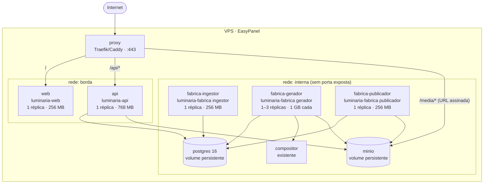
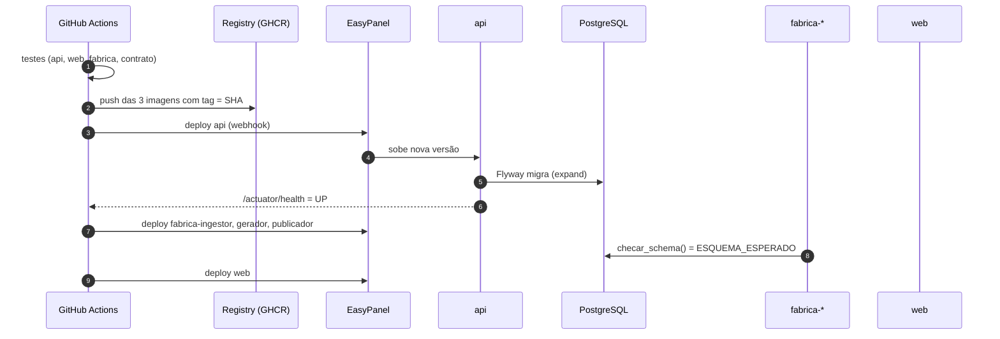

# 10 — Repositório, containers e deploy

## 1. Resposta curta

| Tema | Decisão |
|---|---|
| O Python fica no mesmo repositório? | **Sim.** Um monorepo com `api/`, `web/`, `fabrica/`, `contrato/`, `infra/` e `docs/`. |
| Sobe tudo num Docker só? | **Não.** Uma **imagem por aplicação** (api, web, fabrica) e **um container por processo**. A imagem da fábrica é uma só, rodando em três containers (ingestor, gerador, publicador). |
| Como sobe na VPS? | Cada container é um serviço no EasyPanel (ou um `docker compose` em produção), com imagens geradas pelo CI e publicadas num registry. |

Mesmo repositório **não** significa mesmo container. O repositório junta o que muda junto (o contrato entre banco, Java, Python e front); os containers separam o que roda, cai e escala de forma diferente.

## 2. Por que monorepo

- **Uma mudança de contrato é um PR só.** Um estado novo mexe na migration do Flyway, no enum Java, no enum Python e no selo do front. Em repositórios separados isso vira quatro PRs que precisam ser publicados na ordem certa.
- **O teste de integração da fábrica usa as migrations reais** de `api/src/main/resources/db/migration` (ver [09 §8](09-fabrica-python.md#8-testes)). No mesmo repositório, isso é só um caminho de pasta.
- **Uma versão do sistema = um commit.** Todas as imagens recebem a mesma tag (o SHA do commit); dá para saber exatamente o que está no ar.
- **Time pequeno**: um lugar para clonar, um CI, um histórico.

## 3. Por que não um container único

| Critério | Um container com tudo (supervisord) | Um container por processo |
|---|---|---|
| Runtimes | JVM + Node + Python + FFmpeg na mesma imagem (pesada, difícil de atualizar) | Cada imagem tem só o seu runtime |
| Falha | Gerador estoura memória num vídeo grande → derruba o painel junto | Gerador cai e reinicia sozinho; painel segue no ar (RNF-LUM-04) |
| Deploy | Corrigir um texto do front reinicia a fábrica no meio de uma geração | Cada serviço é publicado sem tocar nos outros |
| Escala | Não dá para ter mais geradores sem duplicar o painel | `gerador` com 2 ou 3 réplicas; o resto com 1 |
| Recursos | Um limite de memória para tudo | Limite por serviço (a JVM não disputa memória com o FFmpeg) |
| Logs e saúde | Misturados; o Docker só vê um processo | Healthcheck e log por serviço no EasyPanel |

O princípio que já guia a arquitetura ("se o painel cair, a fábrica continua") só é verdade se eles forem processos isolados.

## 4. Estrutura do repositório

```
luminaria/
├── api/                         Spring Boot
│   ├── Dockerfile
│   ├── pom.xml
│   └── src/main/resources/db/migration/   ← Flyway (dono único do schema)
├── web/                         Next.js
│   ├── Dockerfile
│   └── package.json
├── fabrica/                     Python (ingestor, gerador, publicador)
│   ├── Dockerfile
│   ├── pyproject.toml           (uv)
│   └── fabrica/
├── contrato/
│   ├── estados.yaml             fonte única dos enums
│   ├── fluxo.schema.json        schema das definições de fluxo (ver 11)
│   └── gerar.py                 gera EstadoX.java, estados.py, estados.ts, R__transicoes.sql
├── infra/
│   ├── compose.dev.yml          ambiente local completo
│   ├── compose.prod.yml         referência dos serviços de produção
│   └── proxy/                   configuração do Traefik/Caddy
├── docs/
└── .github/workflows/
```

## 5. Imagens

| Imagem | Base | Build | Detalhes |
|---|---|---|---|
| `luminaria-api` | `eclipse-temurin:21-jre` | multi-stage com Maven; jar em camadas (`layertools`) | usuário não-root; `-XX:MaxRAMPercentage=75`; healthcheck `/actuator/health` |
| `luminaria-web` | `node:22-alpine` | `next build` com `output: 'standalone'` | só o servidor standalone + `public/` + `.next/static`; healthcheck `/saude` (fora de `/api`, que o proxy manda para o Spring) |
| `luminaria-fabrica` | `python:3.12-slim` + `ffmpeg` | dependências com `uv sync --frozen` | **um** `ENTRYPOINT python -m fabrica`; o papel vem no `command`; healthcheck `python -m fabrica.saude` |
| compositor | imagem existente | — | reaproveitada como está |

Exemplo da fábrica:

```dockerfile
FROM python:3.12-slim
RUN apt-get update && apt-get install -y --no-install-recommends ffmpeg \
 && rm -rf /var/lib/apt/lists/*
COPY --from=ghcr.io/astral-sh/uv:latest /uv /usr/local/bin/uv
WORKDIR /app
COPY pyproject.toml uv.lock ./
RUN uv sync --frozen --no-dev
COPY fabrica/ ./fabrica/
ARG ESQUEMA_ESPERADO
ENV LUM_ESQUEMA_ESPERADO=${ESQUEMA_ESPERADO} PATH="/app/.venv/bin:$PATH"
RUN useradd -r -u 10001 fabrica
USER fabrica
HEALTHCHECK --interval=30s --timeout=5s CMD python -m fabrica.saude || exit 1
ENTRYPOINT ["python", "-m", "fabrica"]
```

`ESQUEMA_ESPERADO` é preenchido pelo CI com a versão da última migration; é o que o worker confere ao subir.

## 6. Serviços em produção



Os números de memória são ponto de partida; revisados com o uso real nas primeiras semanas, já que a VPS é compartilhada com outros serviços.

## 7. Ordem de deploy e migrations



- **A api migra o banco ao subir** (Flyway do Spring Boot). Com uma réplica da api, não há corrida entre migrações.
- **Migrations compatíveis com a versão anterior** (expand → usar → contract em deploys separados). Assim, os workers antigos continuam funcionando durante os segundos entre o deploy da api e o deles, e um rollback de aplicação não exige rollback de banco.
- **Rollback**: publicar de novo a tag anterior em cada serviço. Migration destrutiva (contract) só depois de uma versão estável no ar.

## 8. CI

```yaml
# .github/workflows/ci.yml (resumo)
on: [push, pull_request]
jobs:
  mudancas:            # dorny/paths-filter: api, web, fabrica, contrato
  contrato:            # gera os enums e falha se o código gerado estiver desatualizado
  api:     { needs: mudancas, if: api || contrato }      # mvn verify (Testcontainers, ArchUnit, isolamento de tenant)
  web:     { needs: mudancas, if: web || contrato }      # lint, tsc, vitest, next build
  fabrica: { needs: mudancas, if: fabrica || contrato || api }  # ruff, mypy, pytest com Flyway real
  imagens: { needs: [api, web, fabrica], if: branch == main }    # build + push ghcr.io/<org>/luminaria-*:<sha>
  deploy:  { needs: imagens, environment: producao }             # webhooks EasyPanel na ordem da seção 7 deste documento
```

O job da fábrica também roda quando muda a `api/`, porque mudar uma migration pode quebrar o SQL do Python.

## 9. Ambientes

| Ambiente | Onde | Banco | IA e redes |
|---|---|---|---|
| **Local** | `docker compose -f infra/compose.dev.yml up` (Postgres, MinIO, compositor, fábrica); api e web rodando no IDE com hot reload | Postgres local com seed `dev` | **Falsos** (`LUM_GERADOR=falso`, `LUM_PUBLICADOR=falso`) |
| **Homologação** | Mesma VPS, outro subdomínio, outro banco | Cópia anonimizada de produção | IA real com cota baixa; redes em contas de teste |
| **Produção** | VPS | Postgres de produção | Reais |

## 10. Variáveis por serviço

| Variável | api | fabrica | web |
|---|---|---|---|
| `SPRING_DATASOURCE_URL` / `LUM_DATABASE_URL` | role `luminaria_api` | role `luminaria_worker` | — |
| `SPRING_FLYWAY_USER` / senha | `luminaria_owner` | — | — |
| `LUM_CHAVE_TOKENS` | sim | só `publicador` | — |
| MinIO (endpoint, chaves) | sim (URL assinada) | sim | — |
| Chaves de IA, LLM, TTS | — | só `gerador` | — |
| OAuth das redes (client id/secret) | sim (reconectar) | só `publicador` (renovar token) | — |
| SMTP / e-mail transacional | sim (convite e senha) | — | — |

Cada container recebe só o segredo que usa. Um vazamento no `web` não expõe nenhuma chave.

## 11. Entrada de uma imobiliária nova

A instalação é única para todos os clientes ([ADR-12](decisoes.md#adr-12--um-deploy-multi-tenant)). Um cliente novo é **cadastro**, sem deploy:

1. **Admin → Imobiliárias → Nova imobiliária**: nome, logo, cidade/UF, CRECI.
2. **Plano**: nível, faixa, duração, acessórios; monitores da loja, se contratados.
3. **Automação**: URL do XML, fluxo de automação (padrão ou personalizado), limites técnicos e instruções da legenda.
4. **Usuários**: criados no Admin; cada um recebe convite por e-mail para definir a senha.
5. **Primeiro acesso do cliente**: conecta as redes e monta a grade (ou usa os horários recomendados).
6. **Ler agora** no Admin para a primeira ingestão; os vídeos começam a entrar na fila automática.

Só exige deploy um fluxo personalizado que dependa de **etapa nova** no código da fábrica; nesse caso a etapa sai no deploy normal do sistema e fica disponível para qualquer imobiliária.
