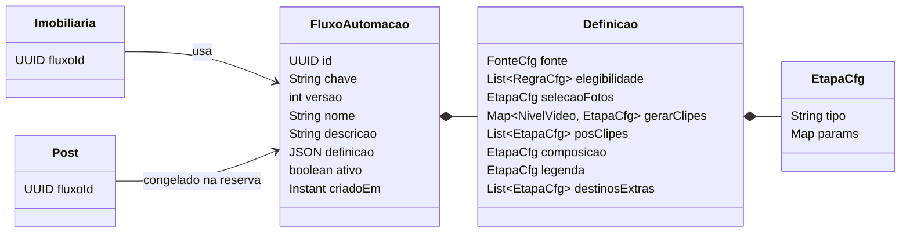
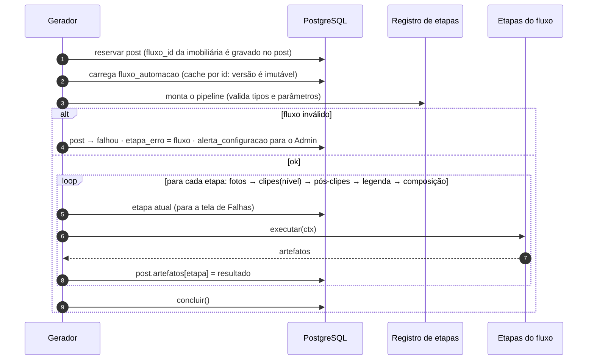

# 11 — Fluxos de automação

Imobiliárias diferentes podem precisar de automações diferentes: outra fonte de imóveis, outro modelo visual, etapas extras, destinos adicionais. Este documento define como o sistema absorve essas variações **sem `if imobiliaria == X` no código** e sem alterar o painel a cada cliente novo.

## 1. Princípio: o que pode variar e o que não pode

```mermaid
flowchart LR
    subgraph fixo["FIXO para todos (contrato do painel)"]
        direction TB
        f1["Máquinas de estado<br/>do imóvel e do post (03)"]
        f2["Aprovação, grade,<br/>agendados, chamados"]
        f3["Franquia e planos"]
        f4["Isolamento por imobiliária"]
    end
    subgraph variavel["VARIÁVEL por cliente (fluxo)"]
        direction TB
        v1["De onde vêm os imóveis<br/>(fonte)"]
        v2["Quem é elegível"]
        v3["Como as fotos são escolhidas"]
        v4["Como o vídeo é gerado<br/>e composto (modelo visual)"]
        v5["Etapas extras<br/>(marca d'água, vinheta…)"]
        v6["Como a legenda é escrita"]
        v7["Para onde vai<br/>(redes, monitores, webhook)"]
    end
    fixo --- variavel
```



Regra: **o fluxo muda o que acontece dentro de `gerando` e na ingestão; ele nunca inventa estados.** Assim o painel (aprovação, catálogo, Dashboard, Admin) funciona igual para todos os clientes, e um fluxo novo não exige deploy do Java nem do front.

O que é variação de **comportamento do cliente** e já existe como configuração da imobiliária (aprovação ligada, modo de publicação, grade, monitores, limites) continua lá. Fluxo é só a **automação**.

## 2. Modelo



- Um **fluxo** é uma definição JSON versionada (`chave` + `versao`). Mudar um fluxo = gravar uma **versão nova**; a anterior fica, imutável.
- A imobiliária aponta para uma versão (`imobiliaria.fluxo_id`). Todas começam no `padrao`.
- O post **congela** a versão do fluxo ao ser reservado (`post.fluxo_id`). Mudar o fluxo da imobiliária não altera um vídeo em produção, e dá para saber exatamente como cada vídeo foi feito (útil nos chamados).
- O **nível do plano continua mandando** no gerador de clipes: o fluxo define *qual* gerador usar para cada nível (`gerarClipes.pro = clipes.ia_pro`), não se o cliente tem IA. Plano é comercial; fluxo é técnico.

### Exemplo: fluxo padrão

```json
{
  "fonte": { "tipo": "xml.vivareal", "params": { "intervalo_min": 60 } },
  "elegibilidade": [
    { "tipo": "minimo_fotos", "params": { "minimo": 4 } },
    { "tipo": "tem_preco" },
    { "tipo": "foto_minima_px", "params": { "lado_menor": 1080 } }
  ],
  "selecaoFotos": { "tipo": "fotos.padrao", "params": { "dedupe": true } },
  "gerarClipes": {
    "essencial": { "tipo": "clipes.zoom_ffmpeg" },
    "pro":       { "tipo": "clipes.ia_pro",   "params": { "prompt": "padrao_pro" } },
    "max":       { "tipo": "clipes.ia_max", "params": { "prompt": "padrao_max" } }
  },
  "posClipes": [],
  "composicao": { "tipo": "composicao.compositor", "params": { "modelo": "rodape_padrao" } },
  "legenda":    { "tipo": "legenda.llm", "params": { "prompt": "padrao" } },
  "destinosExtras": []
}
```

### Exemplo: fluxo personalizado

Campos do XML mapeados de outro jeito, só apartamentos acima de R$ 500 mil, logo como marca d'água, modelo visual próprio e aviso ao site da imobiliária quando publica:

```json
{
  "fonte": { "tipo": "xml.vivareal", "params": { "mapa_campos": "cliente_a" } },
  "elegibilidade": [
    { "tipo": "minimo_fotos", "params": { "minimo": 6 } },
    { "tipo": "filtro", "params": { "tipo_in": ["Apartamento"], "preco_venda_min": 500000 } }
  ],
  "selecaoFotos": { "tipo": "fotos.padrao", "params": { "maximo": 4 } },
  "gerarClipes": { "pro": { "tipo": "clipes.ia_pro", "params": { "prompt": "luxo_lento" } } },
  "posClipes": [ { "tipo": "marca_dagua.logo", "params": { "posicao": "canto_superior_direito", "opacidade": 0.7 } } ],
  "composicao": { "tipo": "composicao.compositor", "params": { "modelo": "cliente_a_v1" } },
  "legenda":    { "tipo": "legenda.llm", "params": { "prompt": "padrao" } },
  "destinosExtras": [ { "tipo": "webhook", "params": { "url_ref": "segredo:cliente_a_webhook" } } ]
}
```

Nenhuma linha de código nova se as etapas já existem: é só uma definição nova.

## 3. Pontos de extensão (catálogo de etapas)

| Ponto | Quando roda | Etapas iniciais | Interface Python |
|---|---|---|---|
| `fonte` | ingestor | `xml.vivareal` (com `mapa_campos` opcional por cliente) | `Fonte.ler(cfg) -> Iterable[ImovelNormalizado]` |
| `elegibilidade` | ingestor | `minimo_fotos`, `tem_preco`, `foto_minima_px`, `filtro` | `Regra.avaliar(imovel) -> Motivo \| None` |
| `selecaoFotos` | gerador | `fotos.padrao` | `SelecaoFotos.escolher(ctx) -> list[Foto]` |
| `gerarClipes` (por nível) | gerador | `clipes.zoom_ffmpeg`, `clipes.ia_pro`, `clipes.ia_max` | `GeradorClipes.gerar(ctx, fotos) -> list[Clipe]` |
| `posClipes` (lista) | gerador | `marca_dagua.logo`, `vinheta.abertura` | `PosProcesso.aplicar(ctx, clipes) -> list[Clipe]` |
| `composicao` | gerador | `composicao.compositor` (com `modelo` visual) | `Composicao.montar(ctx, clipes) -> Peca` |
| `legenda` | gerador | `legenda.llm` | `Legenda.escrever(ctx) -> LegendaGerada` |
| `destinosExtras` (lista) | publicador, após publicar | `webhook` | `DestinoExtra.notificar(ctx, publicacoes)` |

Acessórios do plano (Motion Graphics e Locução) continuam vindo do **plano**: a composição recebe `ctx.acessorios` e escolhe a variante do modelo; a locução é inserida pela etapa de composição. O fluxo não liga nem desliga acessórios pagos.

### Registro

```python
# fabrica/etapas/registro.py
_REGISTRO: dict[str, type] = {}

def etapa(tipo: str):
    def decorar(cls):
        if tipo in _REGISTRO:
            raise RuntimeError(f"Etapa duplicada: {tipo}")
        _REGISTRO[tipo] = cls
        return cls
    return decorar

def criar(cfg: EtapaCfg, deps: Dependencias):
    try:
        cls = _REGISTRO[cfg.tipo]
    except KeyError:
        raise FluxoInvalido(f"Etapa desconhecida: {cfg.tipo}")
    return cls(params=cls.Params.model_validate(cfg.params or {}), deps=deps)

# fabrica/etapas/pos_clipes/marca_dagua.py
@etapa("marca_dagua.logo")
class MarcaDaguaLogo:
    class Params(BaseModel):
        posicao: Literal["canto_superior_direito", "canto_inferior_direito"] = "canto_superior_direito"
        opacidade: confloat(ge=0.1, le=1.0) = 0.7
    def aplicar(self, ctx, clipes): ...
```

Cada etapa declara seus parâmetros com Pydantic: parâmetro errado é recusado ao **carregar** o fluxo, não no meio da geração.

### Código específico de um cliente

Quando uma necessidade não cabe em parâmetros, ela vira **uma etapa nova** com prefixo do cliente, em `fabrica/etapas/clientes/<cliente>/`, com testes próprios:

```python
@etapa("cliente.cliente_a.fonte_api")
class FonteApiClienteA: ...
```

Fica explícito, testável e isolado: apagar o cliente é apagar a pasta. O que **não** se faz: `if imobiliaria_id == ...` dentro de uma etapa comum.

## 4. Execução no gerador



- `etapa_erro` passa a guardar o **tipo da etapa** que falhou (`clipes.ia_pro`, `marca_dagua.logo`), o que deixa a tela de Falhas exata.
- O **reaproveitamento no refazer** ([09 §4.2](09-fabrica-python.md#42-reaproveitamento-no-refazer-rn-lum-01)) funciona por etapa: o escopo diz quais etapas rodam de novo; as outras reaproveitam `artefatos` do post de origem.
- O **ingestor** usa a mesma ideia: lê `fonte` e `elegibilidade` do fluxo da imobiliária.
- O **publicador** roda `destinosExtras` depois das redes; falha num destino extra é registrada, mas nunca desfaz a publicação.

## 5. Validação em três lugares

| Onde | O quê |
|---|---|
| `contrato/fluxo.schema.json` | Estrutura da definição (JSON Schema), lista de tipos de etapa conhecidos |
| Java, ao salvar no Admin | Valida contra o schema antes de gravar; recusa tipo desconhecido |
| Python, ao carregar | Valida tipos e parâmetros de cada etapa (Pydantic); fluxo inválido nunca roda pela metade |

Mais um teste no CI: **todo fluxo gravado nas migrations/seeds carrega sem erro** no registro do Python.

## 6. Administração

**v1 (simples):**

- A tabela `fluxo_automacao` é populada por migration (`R__fluxos.sql`) — fluxos são código revisado, não configuração editada em produção.
- No Admin, no detalhe da imobiliária, um campo **Fluxo de automação** com a lista de fluxos ativos (nome + versão + descrição). Trocar de fluxo grava evento.
- Na tela de Consumo e Falhas, filtro por fluxo.

**Evolução prevista:** editor de JSON com validação no Admin, criando versões novas sem deploy; **nunca** editar uma versão existente.

### Banco

```sql
CREATE TABLE luminaria.fluxo_automacao (
  id         uuid PRIMARY KEY,
  chave      text NOT NULL,              -- 'padrao', 'cliente_a'
  versao     int  NOT NULL,
  nome       text NOT NULL,
  descricao  text,
  definicao  jsonb NOT NULL,
  ativo      boolean NOT NULL DEFAULT true,
  criado_em  timestamptz NOT NULL DEFAULT now(),
  UNIQUE (chave, versao)
);
ALTER TABLE luminaria.imobiliaria ADD COLUMN fluxo_id uuid NOT NULL REFERENCES luminaria.fluxo_automacao(id);
ALTER TABLE luminaria.post        ADD COLUMN fluxo_id uuid REFERENCES luminaria.fluxo_automacao(id);

-- versões são imutáveis
CREATE TRIGGER fluxo_imutavel BEFORE UPDATE OF definicao, chave, versao ON luminaria.fluxo_automacao
  FOR EACH ROW EXECUTE FUNCTION luminaria.trg_recusar_alteracao();
```

`fluxo_automacao` é global (não tem `imobiliaria_id`): um fluxo pode servir a vários clientes. O worker só lê; o Java lê e muda `imobiliaria.fluxo_id`.

## 7. Limites do mecanismo

O fluxo cobre variações de **automação**. Ficam fora dele, por decisão de projeto:

| Necessidade | Onde é tratada |
|---|---|
| Aprovação, modo de publicação, grade, monitores, limites | Configuração da imobiliária (já existente) |
| Nível de vídeo e acessórios | Plano da imobiliária |
| Regras de aprovação diferentes (ex.: duas aprovações) | Evolução da máquina de estados ([03](03-ciclo-de-vida.md)), com ADR própria — nunca dentro de um fluxo |
| Legenda | Sempre pela etapa `legenda.*`; um cliente pode ter prompt próprio, nunca legenda fixa |

