# 13 — Plano de desenvolvimento do Luminaria

Data: 21/10/2026 · Situação: planejamento inicial; implementação ainda não iniciada.

## 1. Objetivo e base do plano

Entregar o SaaS multi-imobiliária descrito em [00 — Visão geral](00-visao-geral.md): importar a carteira XML, gerar vídeos, permitir revisão e agendamento e publicar por rede com rastreabilidade. Este plano transforma os documentos 00 a 12 e as ADRs em uma sequência executável.

Na revisão inicial, o repositório contém documentação e instruções; as pastas de aplicação descritas ainda precisam ser criadas. Listagens de comandos e exemplos nos documentos são especificações, não funcionalidades já entregues.

**Confirmado pelo responsável em 21/10/2026:** implantação no **EasyPanel** e banco **PostgreSQL**. Adotar PostgreSQL 16 como versão de referência, conforme a ADR-13. SQLite não fará parte da aplicação nova. Se houver SQLite no pipeline anterior, será apenas uma fonte da migração de dados.

### Decisões que orientam a execução

| Área | Base de implementação |
|---|---|
| Backend | Java 21, Spring Boot 3, monólito modular |
| Frontend | Next.js, TypeScript, TanStack Query, identidade Lumina |
| Fábrica | Python 3.12; ingestor, gerador e publicador |
| Integração | Somente PostgreSQL entre API e fábrica; filas com SKIP LOCKED, sinais com LISTEN/NOTIFY e polling de recuperação |
| Schema | Flyway como único responsável; schema luminaria; migrations compatíveis com a aplicação anterior |
| Mídia | MinIO privado; URLs assinadas após autorização |
| Isolamento | Tenant da sessão, filtro na aplicação e RLS no PostgreSQL |
| Automação | Fluxos JSON imutáveis e versionados, executados por etapas Python |
| Publicação | Instagram, TikTok e YouTube independentes |
| Operação | EasyPanel; imagens com a mesma tag de commit; um deploy atende todas as imobiliárias |

Há **cinco processos próprios**: API, web, ingestor, gerador e publicador. Isso não significa cinco serviços no ambiente inteiro: PostgreSQL, MinIO e compositor também precisam ser provisionados ou conectados; o proxy é fornecido/configurado na infraestrutura. São três imagens próprias, pois os três workers usam a mesma imagem Python.

A discussão sobre transformar Python em n8n não equivale a uma decisão arquitetural. O plano segue as ADRs 02, 03, 10, 11 e 13. Uma substituição futura exige avaliação e ADR própria, preservando transações, isolamento, retomada e matriz de escrita.

## 2. Como executar e acompanhar

Cada bloco deve originar uma tarefa rastreável e um ou mais PRs pequenos. A ordem abaixo privilegia entregas que podem ser demonstradas de ponta a ponta. Backend, interface, testes e documentação da funcionalidade são concluídos no mesmo bloco; não deixar toda a integração para o final.

- **P0:** necessário antes de operar o piloto real.
- **P1:** necessário para completar a v1 documentada.
- **P2:** evolução posterior, fora do compromisso da v1.
- **Estado inicial de todos os blocos:** a fazer. Este documento não registra funcionalidades como concluídas.
- **Responsáveis:** a atribuir antes de iniciar cada fase; papéis sugeridos são produto, backend, frontend, fábrica e operação.
- **Estimativas:** definir após o inventário da fase 0 e recalibrar ao concluir a primeira entrega integrada. Não há prazo fechado nem capacidade de equipe confirmada.

Um bloco termina com evidência verificável: PR, resultado de teste, demonstração ou registro de homologação. A fase só termina quando seu critério de saída é atendido. Se uma decisão pendente mudar um contrato, atualizar a especificação e a ADR antes de implementar a área.

## 3. Mapa das fases

| Fase | Entrega | Prioridade | Depende de |
|---|---|---|---|
| 0 | Inventário, decisões pendentes e preparação externa | P0 | — |
| 1 | Monorepo executável, contratos e ambiente local | P0 | 0 |
| 2 | PostgreSQL, integridade, isolamento e franquia | P0 | 1 |
| 3 | Acesso seguro e cadastro inicial de imobiliárias | P0 | 2 |
| 4 | Ingestão XML e carteira utilizável | P0 | 3 |
| 5 | Geração Essencial até aprovação no painel | P0 | 4 |
| 6 | Aprovação, rejeição, chamados e grade | P0 | 5 |
| 7 | Publicação real e piloto operacional | P0 | 6 e acessos externos |
| 8 | Planos completos, IA e fluxos de automação | P1 | 5–7 |
| 9 | Funcionalidades restantes e operação completa da v1 | P1 | 6–8 |
| 10 | Migração definitiva, homologação e lançamento | P0/P1 | 7–9 |

```mermaid
flowchart LR
    F0["0 · Preparação"] --> F1["1 · Base"]
    F1 --> F2["2 · Banco"]
    F2 --> F3["3 · Acesso"]
    F3 --> F4["4 · Carteira"]
    F4 --> F5["5 · Vídeo Essencial"]
    F5 --> F6["6 · Revisão e grade"]
    F6 --> F7["7 · Publicação e piloto"]
    F7 --> F8["8 · IA e planos"]
    F8 --> F9["9 · v1 completa"]
    F9 --> F10["10 · Lançamento"]
```

As contas e permissões externas começam na fase 0 e avançam enquanto o produto é implementado. O piloto P0 é uma entrega intermediária com escopo reduzido e acordado; não deve ser anunciado como a v1 completa.

## 4. Fase 0 — Preparação e fechamento dos contratos

**Objetivo:** remover ambiguidades que afetariam banco, workers e operação.

### B00 — Inventário do pipeline anterior [P0]

- Localizar código Python existente, compositor, modelos visuais, origem dos XMLs e armazenamento atual.
- Identificar banco anterior, tabelas, estados, IDs, credenciais necessárias e histórico que precisa ser preservado, sem copiar segredos para o repositório.
- Mapear o que será reaproveitado, adaptado ou refeito; registrar volume e qualidade dos dados.
- Produzir inventário e matriz origem → destino para a migração da ADR-14.

**Aceite:** origem dos dados e dependências acessíveis e documentadas; itens indisponíveis possuem responsável e impacto explícitos. Não presumir que o pipeline anterior está neste repositório.

### B01 — Resolver lacunas técnicas antes do schema [P0]

- Revisar a matriz de escrita: o Admin pede retry por rede, embora a tabela resumida atribua publicação ao Python; definir permissões de coluna e transições exatas.
- Definir consumo de franquia em falha, retomada e reprocessamento, garantindo uma única cobrança lógica por post.
- Definir confirmação de lease por tentativa para impedir conclusão de um processamento antigo após nova reserva.
- Resolver entrega de eventos com commits fora de ordem: a janela fixa de 2 segundos descrita no documento 02 precisa de teste com transação longa; não aceitá-la como garantia de não perder eventos.
- Confirmar RLS com roles reais, contexto administrativo e escopo dos workers; testar reset do contexto no pool.
- Revisar exemplos SQL antes de convertê-los em migrations: ordem das FKs, extensões necessárias (incluindo btree_gist), expressões indexáveis e comparação de versões Flyway.
- Conciliar checagem estrita de versão do worker com a janela expand/contract e o procedimento de reinício/rollback.
- Revisar a máquina de estados para indisponibilidade durante geração/publicação e aprovação automática.

**Aceite:** decisões registradas nos documentos afetados e, quando estruturais, em ADR; cenários críticos convertidos em casos de teste. Este bloco não altera silenciosamente decisões existentes.

### B02 — Preparar provedores, contas e infraestrutura [P0]

- Confirmar VPS, domínio, EasyPanel, registry, SMTP, MinIO e disponibilidade do compositor.
- Definir provedores reais de clipes Pro/Max, LLM e locução, com orçamento inicial de homologação.
- Iniciar cadastro e obtenção das permissões dos aplicativos nas três redes; confirmar requisitos atuais nos documentos oficiais durante a implementação.
- Disponibilizar XML anonimizado e contas de teste; estabelecer uma imobiliária piloto.
- Atribuir responsáveis e dimensionar a primeira fase.

**Aceite:** checklist de acessos por responsável, dependências externas e limites de gasto definidos. Uma rede sem permissão de publicação real permanece bloqueada para lançamento público, mesmo se funcionar com adaptador falso.

**Saída da fase:** arquitetura confirmada, inventário disponível e pendências externas rastreáveis.

## 5. Fase 1 — Fundação executável

### B03 — Estrutura e ferramentas [P0]

- Criar api/, web/, fabrica/, contrato/ e infra/ conforme documentos 10 e 12.
- Inicializar projetos e versões compatíveis com a stack documentada; registrar dependências em arquivos de lock.
- Criar configuração por ambiente, arquivos de exemplo sem segredos e instruções reproduzíveis.
- Implementar estrutura modular, verificações de fronteira e endpoints básicos de saúde.

**Aceite:** um clone limpo permite instalar, compilar e executar os três projetos; nenhum comando documentado depende de arquivo inexistente.

### B04 — Contrato compartilhado [P0]

- Criar estados.yaml, fluxo.schema.json e gerador de enums, transições e cores de estado.
- Gerar artefatos Java, Python, TypeScript e SQL; versionar os resultados.
- Definir contrato inicial OpenAPI e geração dos tipos consumidos pelo frontend.
- Validar o fluxo padrão e detectar divergência de artefatos no CI.

**Aceite:** regenerar não produz diferenças inesperadas; uma mudança de contrato inconsistente falha no CI.

### B05 — Ambiente local e CI inicial [P0]

- Criar Compose de desenvolvimento com PostgreSQL, MinIO, compositor ou substituto local de teste e workers.
- Implementar provedores falsos de geração/publicação, desligando chamadas pagas por padrão.
- Preparar testes Java, web e Python; CI deve validar também a fábrica quando migrations mudarem.
- Criar dados sintéticos de duas imobiliárias apenas em desenvolvimento/testes.

**Aceite:** ambiente local sobe de forma reproduzível e o CI executa as verificações pertinentes.

**Saída da fase:** base executável e contratos versionados; ainda não há produto pronto para clientes.

## 6. Fase 2 — PostgreSQL e garantias de domínio

### B06 — Schema e migrations [P0]

- Implementar progressivamente entidades dos documentos 04 e 11, infraestrutura de sessão/eventos/filas e fluxo padrão.
- Criar FKs compostas, unicidades, restrições de plano, agendamento e produção por imóvel.
- Implementar transições por ator, updates condicionais, eventos transacionais e sinais após commit.
- Separar usuário dono do schema, API e workers; Python nunca executa DDL.
- Não copiar exemplos SQL sem executar a sequência completa de migrations.

**Aceite:** banco vazio migra com sucesso; reaplicar não altera migrations aplicadas; transições e vínculos inválidos são recusados.

### B07 — Isolamento multi-imobiliária [P0]

- Implementar RLS, TenantContext, contexto transacional e permissões conforme matriz revisada.
- Provar acesso fechado sem tenant e isolamento inclusive em tabelas filhas, consultas nativas e mídia.
- Tratar acesso administrativo explicitamente e registrar ações sensíveis.
- Criar suíte de isolamento extensível a cada endpoint novo.

**Aceite:** role da API sem contexto vê zero dados de cliente; imobiliária A não lê nem altera recursos de B; pool não reaproveita tenant anterior.

### B08 — Franquia, concorrência e tempo [P0]

- Implementar fn_saldo_franquia, reserva com trava por imobiliária e consumo idempotente.
- Cobrir plano ilimitado, sobras, virada do mês, fechamento repetido e mudança de plano.
- Uniformizar UTC no armazenamento e America/Sao_Paulo nos cálculos comerciais.
- Implementar primitivas de lease, reserva de fila e proteção contra worker atrasado.

**Aceite:** dois geradores não consomem a última vaga simultaneamente; retry não duplica consumo; resultados da API e da fábrica concordam.

**Saída da fase:** contrato de banco testado com PostgreSQL real e roles reais, não apenas mocks.

## 7. Fase 3 — Acesso e administração inicial

### B09 — Identidade e sessão [P0]

- Login/logout, sessão JDBC, cookie seguro, CSRF e proteção contra abuso.
- Convite e recuperação de senha por token de uso único; SMTP em homologação.
- Desativação revoga sessões; Admin e cliente recebem permissões distintas.
- Implementar acesso inicial administrativo por procedimento controlado, sem senha fixa em seed de produção.

**Aceite:** login, convite, expiração, redefinição, revogação e autorização testados; tenant vem exclusivamente da sessão.

### B10 — Base visual e navegação [P0]

- Aplicar UI Kit descrito nos documentos 07 e 08; casca cliente/Admin, login e estados de erro.
- Cliente HTTP com CSRF e ProblemDetail; cache limpo ao sair/trocar conta.
- Layout móvel de 360 px e desktop, navegação por teclado e foco visível.
- Gerar tipos de API; servidor continua sendo responsável por autorizar.

**Aceite:** login leva à área correta; estados carregando/vazio/erro e expiração de sessão funcionam nos dois tamanhos.

### B11 — Cadastro operacional mínimo [P0]

- Admin cadastra imobiliária, plano Essencial, XML, fluxo padrão, grade e usuários.
- Cliente consulta plano e altera dados/configurações autorizados.
- Auditabilidade de mudanças e upload seguro de logo.
- Campos de conexão das redes são preparados para a fase 7.

**Aceite:** cadastrar uma nova imobiliária não exige deploy nem edição direta no banco.

**Saída da fase:** equipe consegue preparar duas imobiliárias isoladas pelo painel.

## 8. Fase 4 — Ingestão e carteira

### B12 — Ingestor XML [P0]

- Reaproveitar/adaptar parser VivaReal após inventário; normalizar dados, fotos e hash.
- Detectar novos/alterados/ausentes, executar leitura periódica e comando Ler agora.
- Proteger XML vazio, incompleto, falha de download e remoção em massa; validar URLs externas e impor limites de download.
- Registrar ingestões e eventos; impedir duplicação e alteração indevida de vídeos já gerados.

**Aceite:** XML repetido não duplica imóveis; falha/vazio não remove carteira; alterações e saídas válidas ficam rastreáveis.

### B13 — Catálogo e detalhe [P0]

- API e telas de catálogo, filtros/ordenação na URL, paginação, contagens e busca tolerante.
- Detalhe com fotos, estados, versões e linha do tempo.
- MinIO privado e URLs assinadas após autorização; carregar mídia sob demanda.
- Preparar ações de geração e seleção de fotos.

**Aceite:** usuário consulta apenas a própria carteira e compartilha URL de filtro; recurso de outra imobiliária retorna 404.

**Saída da fase:** XML alimenta uma carteira navegável e auditável, mesmo com gerador desligado.

## 9. Fase 5 — Primeiro vídeo completo

### B14 — Motor da fábrica e fila [P0]

- Implementar registro de etapas, validação Pydantic e fluxo padrão versionado.
- Reservar post, congelar fluxo/plano, validar franquia e concluir por transações curtas.
- Implementar retries classificados, heartbeat, reaper, desligamento e retomada de artefatos.
- Nunca manter transação aberta durante rede, IA, FFmpeg ou MinIO.

**Aceite:** queda do worker e perda de NOTIFY não perdem trabalho; réplicas não processam a mesma reserva; resposta antiga não sobrescreve a tentativa atual.

### B15 — Geração Essencial [P0]

- Selecionar fotos válidas e respeitar escolha do cliente.
- Gerar zoom FFmpeg, integrar compositor, produzir vídeo vertical/capa e legenda por adaptador LLM.
- Salvar artefatos e mídia; distinguir mensagem técnica e mensagem para o usuário.
- Implementar Gerar agora e prioridade; limites diários e bloqueio por franquia.

**Aceite:** imóvel de teste produz vídeo reproduzível, capa e legenda; arquivo é reproduzível no painel e pertence ao tenant correto.

### B16 — Revisão inicial no painel [P0]

- Lista de pendentes, detalhe/player, status e estimativa, atualização automática condicional.
- Edição de legenda/hashtags separada da IA; limites por rede vindos da API.
- Mostrar franquia e erros acionáveis.
- Acrescentar notificações mínimas de vídeo pronto e falha.

**Aceite:** demonstrar XML → imóvel → gerar → vídeo pendente → edição persistida após recarregar, sem publicação automática indevida.

**Saída da fase:** primeira entrega integrada demonstrável, inicialmente com provedores falsos e depois com mídia real de homologação.

## 10. Fase 6 — Decisões, grade e suporte

### B17 — Aprovação e agendamento [P0]

- Aprovar ao momento atual ou conforme grade, com/sem encaixe automático.
- Alterar/cancelar agendamento, horários recomendados e visualização dos próximos sete dias.
- Conflito de horário responde 409; uma única alocação ativa por post.
- Aprovação desligada usa aprovado_auto e alocação pelo Java, nunca pelo Python.

**Aceite:** duas aprovações concorrentes não ocupam o mesmo horário; grade vazia e mudança de estado possuem respostas claras; nenhum envio começa antes de agendamento válido.

### B18 — Rejeição, refação e chamado [P0]

- Primeira rejeição cria versão prioritária sem franquia adicional; reaproveitar etapas conforme categoria.
- Segunda rejeição abre chamado e bloqueia geração automática do imóvel.
- Admin compara versões e resolve por refazer, devolver ou descartar; registrar nota para cliente e evento.
- Validar categorias pelo nível/acessórios usados no post, não pelo plano atual.

**Aceite:** duas rejeições seguem a máquina de estados, sem terceira geração automática; edição manual não é sobrescrita.

### B19 — Descarte, saída da carteira e eventos [P0]

- Não postar, desfazer descarte, confirmar venda/locação e post Vendido somente após confirmação.
- Processar eventos com retomada e deduplicação conforme decisão do B01; notificações e lembrete de 48 h.
- Cobrir concorrência entre ingestão, aprovação e geração.
- Documentar seções da v1 que ainda estarão indisponíveis no piloto.

**Aceite:** replay não duplica efeitos; eventos não são perdidos por commits fora de ordem; saída do XML não publica Vendido sozinha.

**Saída da fase:** controle editorial completo do caminho Essencial; publicador falso confirma integração.

## 11. Fase 7 — Redes e piloto no EasyPanel

### B20 — OAuth e proteção dos tokens [P0]

- Conectar/reconectar redes, validar callbacks e vincular conta ao tenant autorizado.
- Implementar AES-256-GCM compatível Java/Python, renovação e expiração.
- Exibir rede desconectada e manter publicação aguardando conexão.
- Validar permissões reais, escopos e limites atuais usando documentação oficial.

**Aceite:** teste cruzado de criptografia passa; tokens não aparecem no navegador/logs; reconexão retoma apenas itens autorizados.

### B21 — Publicador por rede [P0]

- Implementar adaptadores Instagram, TikTok e YouTube, com tentativas e resultado por rede.
- Publicar agendamento vencido, preservar legenda editada e registrar atraso.
- Reconciliar confirmação externa em timeout/queda antes de repetir; não prometer exactly-once sem suporte do provedor.
- Permitir retry administrativo somente da rede que falhou; uma confirmação marca post publicado sem cancelar outras redes.

**Aceite:** sucesso em uma rede e falha em outra ficam independentes; retry não repete publicação já confirmada; conta desconectada aguarda.

### B22 — Entrega de homologação no EasyPanel [P0]

- Criar imagens API/web/fábrica com tag SHA e configurar os cinco processos.
- Provisionar/conectar PostgreSQL, MinIO e compositor; volumes, rede interna, HTTPS e proxy na mesma origem.
- Separar homologação e produção; healthchecks, limites, logs e segredos por papel.
- Automatizar CI e publicação de imagens; implantar API/migrations → workers → web e testar rollback de aplicação.
- Configurar backup PostgreSQL e preservação de mídia/chaves; ensaiar restauração.

**Aceite:** stack de homologação funciona após reinício; banco não está público; mídia assinada é acessível ao provedor pelo tempo necessário; restauração validada.

### B23 — Piloto controlado [P0]

- Ativar uma imobiliária de teste autorizada com Essencial e conta de teste da primeira rede liberada.
- Executar XML → vídeo real → aprovação → horário → publicação → link e histórico.
- Medir custo, duração de geração, memória, filas e falhas; ajustar limites.
- Liberar cada rede somente depois de teste real e permissões confirmadas.
- Registrar feedback e corrigir bloqueadores antes de ampliar.

**Aceite:** demonstração completa no EasyPanel, evidência de publicação, suporte e recuperação disponíveis. Rede ainda não liberada é explicitamente indisponível no piloto.

**Saída da fase:** piloto operacional restrito; v1 continua dependendo das fases 8–10.

## 12. Fase 8 — Planos e geração completa

### B24 — Pro, Max e acessórios [P1]

- Integrar geradores reais Pro/Max, jobs assíncronos e retomada por identificador externo.
- Implementar Motion Graphics e locução, duração contratada e restrições por plano.
- Aplicar limites de custo, timeout e controle de chamadas pagas.
- Homologar qualidade visual e refação por categoria em cada nível.

**Aceite:** matriz Essencial/Pro/Max e acessórios permitidos testada; falha/retry não cria pedido pago desnecessário; artefatos identificam provedor e versão utilizados.

### B25 — Gestão comercial e fluxos [P1]

- Completar troca de plano imediata/programada, sobras e fechamento mensal idempotente.
- Admin seleciona versões ativas do fluxo; versões anteriores permanecem imutáveis.
- Validar todos os fluxos de migrations/seeds no registro Python; congelar versão por post.
- Testar pelo menos uma variação de fluxo por configuração, sem condicional por cliente.
- Manter editor visual/JSON de fluxos fora da v1.

**Aceite:** troca do fluxo não muda post em andamento; painel e fábrica mostram o mesmo saldo nas viradas comerciais.

**Saída da fase:** níveis e automações da v1 utilizáveis com controles de custo.

## 13. Fase 9 — Completar a experiência da v1

### B26 — Produtividade e monitores [P1]

- Aprovação em lote com resultado por item e seleção de fotos completa.
- Geração só para monitores, playlist segregada por token revogável e tela da lista de vídeos.
- Garantir que monitores nunca entrem na aprovação, grade ou redes.
- Concluir post Vendido com modelo visual e validação em homologação.
- Página completa dos monitores permanece fora da v1, conforme documento 00.

**Aceite:** lote relata conflitos individualmente; vídeo exclusivo de monitor não é publicado em rede e obedece à regra de franquia.

### B27 — Dashboard, avisos e configurações [P1]

- Números por período, gráficos por rede, carteira por estado, últimos publicados e tempo economizado.
- Concluir sino, leitura de avisos, faixas de conexão e extrato de franquia.
- Autosave de configurações, instruções de legenda, dados da imobiliária e plano somente leitura.
- Validar mobile, acessibilidade e carregamento de mídia/gráficos sob demanda.

**Aceite:** relatórios conciliam com dados do banco e respeitam tenant/período/fuso; filtros sobrevivem ao recarregamento.

### B28 — Administração completa [P1]

- Completar imobiliárias, usuários/convites, chamados, consumo/CSV, horários recomendados e filtros por fluxo.
- Falhas por etapa/rede, retry seguro, leitura XML sob demanda e saúde por heartbeat/fila.
- Entrar como imobiliária somente leitura, com trilha de auditoria e bloqueio de escrita no servidor.
- Expor ações necessárias para operação sem SQL manual.

**Aceite:** equipe resolve chamado, identifica worker parado e trata falha isolada pelo painel, sem violar a máquina de estados.

**Saída da fase:** todas as telas e requisitos da v1 possuem entrega e evidência associadas.

## 14. Fase 10 — Migração, qualidade e lançamento

### B29 — Migração do pipeline anterior [P0/P1]

- Implementar importador versionado com modo de simulação, mapeamento de IDs, estados, tenants, mídia e histórico.
- Se houver SQLite, extrair de cópia controlada; não manter escrita paralela sem estratégia explícita.
- Ensaiar com dados anonimizados e conciliar contagens, relações, links de mídia e franquia.
- Definir fonte responsável por publicações já iniciadas, janela de pausa e prevenção de duplicação durante o corte.
- Registrar plano de retorno: após novas escritas/publicações, voltar ao pipeline anterior exige reconciliação, não apenas restaurar banco antigo.

**Aceite:** relatório de reconciliação sem divergência crítica; execução repetida não duplica entidades; plano de corte e retorno ensaiado.

### B30 — Homologação funcional e resiliência [P0/P1]

- Executar matriz completa de RF/RN/RNF com duas imobiliárias e roles de produção.
- Testar réplicas, última vaga de franquia, clique duplo, cancelamento concorrente, retomada, perda de sinal e falha parcial.
- Confirmar que parar API mantém trabalho possível da fábrica e parar fábrica preserva painel; aprovado_auto aguarda o Java sem perder intenção.
- Validar isolamento de APIs, mídia, CSV, avisos, monitores e modo Entrar como.
- Medir abertura < 2 s em perfil 4G documentado e carga de referência ~10 imobiliárias × 2.000 imóveis; registrar método e resultado.
- Concluir publicação real nas três redes e teste de restauração de banco/mídia.

**Aceite:** bloqueadores resolvidos; cobertura da v1 registrada; limitações aceitas explicitamente pelo responsável, sem marcar requisito não entregue como concluído.

### B31 — Corte e operação assistida [P0/P1]

- Fazer backup, pausar produtores anteriores, executar migração final e conferir saldos/agendamentos.
- Publicar no EasyPanel na ordem prevista, rodar smoke e liberar clientes gradualmente.
- Entregar runbook de deploy, rollback, restauração, rotação de segredos, onboarding e incidentes.
- Acompanhar filas, custos, uso de recursos, conexões e publicações diariamente durante a estabilização.
- Encerrar estabilização quando não houver incidente crítico aberto e as rotinas de operação tiverem evidência.

**Aceite:** dados conciliados, fluxo real validado, responsáveis de suporte definidos e operação aprovada pelo responsável do projeto.

## 15. Rastreabilidade dos requisitos

Os códigos completos e critérios de comportamento permanecem no [catálogo de requisitos](00-visao-geral.md#6-catálogo-de-requisitos); esta tabela indica onde entregar e verificar cada grupo.

| Requisitos | Blocos principais |
|---|---|
| RF 01–03: identidade e isolamento | B07, B09, B10 |
| RF 10–18: aprovação, legenda, rejeição, saída | B16–B19, B26 |
| RF 20–27: carteira, busca, gerar e fotos | B12–B16, B19, B26 |
| RF 30–31: monitores | B26 |
| RF 40–43, 45–46: Dashboard | B27 |
| RF 50–55: configurações, redes e plano | B11, B17, B20, B27 |
| RF 60–67: Admin | B11, B18, B22, B25, B28 |
| RF 70: avisos | B16, B19, B27 |
| RF 80–83: franquia e mudança de plano | B08, B16, B25 |
| RN 01–02: rejeição/chamado | B18 |
| RN 03–04: aprovação e grade | B17, B19 |
| RN 05–07: atraso, irreversibilidade e independência | B21 |
| RN 08–12: legenda, vendido, monitores, auditoria e XML | B06, B12, B16, B19, B26 |
| RN 13–15: franquia e acessórios | B08, B24, B25 |
| RNF 01–03: desempenho, responsividade e escala | B10, B13, B27, B30 |
| RNF 04–05: desacoplamento e segurança | B07, B14, B20–B22, B30 |
| RNF 06–09: identidade, localização, evolução, domínio único | B04, B10, B22, B25, B27 |

## 16. Critério comum de conclusão de um bloco

- Comportamento demonstrado e critérios específicos atendidos.
- Testes apropriados: domínio; integração PostgreSQL/Flyway e roles; isolamento de endpoints; contrato entre linguagens; interface nos dois tamanhos.
- CI pertinente aprovado e PR revisado; nenhuma credencial ou dado real inserido no repositório.
- Schema alterado somente por migration nova; contrato regenerado quando necessário.
- Mudanças de estado condicionais e eventos na mesma transação; chamadas externas fora da transação.
- Documentação afetada atualizada; limitações e dependências registradas.
- Evidência anexada à tarefa e estado atualizado somente depois da verificação.

## 17. Riscos e dependências de maior impacto

| Risco | Ação e ponto de controle |
|---|---|
| Aprovação de apps/permissões nas redes | Começar B02 imediatamente; validar em B20/B21; não liberar rede sem teste real |
| Código/dados/compositor anteriores indisponíveis | Inventariar em B00; reestimar B15/B29 se reaproveitamento não for possível |
| Custo e duração de IA | Provedores falsos em dev; orçamento em B02; retomada e limites em B14/B24 |
| Duplicação de publicação após timeout | Reconciliação externa e idempotência por adaptador em B21 |
| Vazamento entre imobiliárias | RLS e roles reais em B07; testes obrigatórios por endpoint e B30 |
| Consumo de franquia divergente | Função única e concorrência em B08; conciliação B25/B29 |
| Perda de eventos por ordem de commit | Resolver B01 e provar em B19, incluindo transação longa |
| Memória da VPS compartilhada | Medir vídeo real no piloto; limites por processo em B22/B23 |
| Migração e corte publicarem conteúdo duas vezes | Pausar pipeline anterior e reconciliar em B29/B31 |
| Escopo crescer antes da primeira entrega | Priorizar Essencial integrado; preservar evolução P1 em vez de bloquear piloto |

## 18. Evoluções posteriores [P2]

Permanecem fora da v1: vídeos próprios externos, página completa de monitores, editor visual do rodapé, métricas de desempenho das redes, busca em linguagem natural, avisos WhatsApp/e-mail, app nativo e calendário com arrastar. Editor de fluxos e eventual adoção de n8n exigem planejamento próprio.

**Próxima execução recomendada:** iniciar B00, B01 e B02; depois implementar B03–B05. Não começar por todas as telas nem por provedores pagos antes de fechar o contrato de dados.
